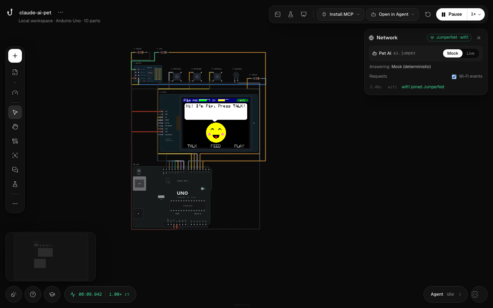
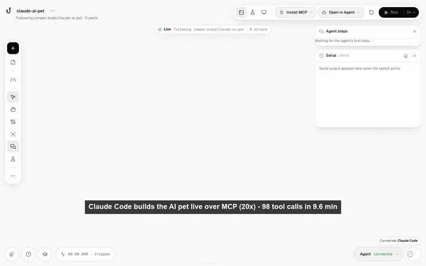

<p align="center">
  
</p>

<p align="center"><strong>Figma for hardware, with a real simulator underneath.</strong></p>

Jumper is an open-source browser sandbox for electronics. You place parts on a canvas, wire their pins together, and run the real compiled firmware on an emulated microcontroller. The LED on the canvas lights up because the emulated ATmega328P set its pin high and a small circuit solver pushed current through the resistor and the LED. It is not a drawing of what should happen. Anything a person can do on the canvas, an AI agent will be able to do through the same tools.

**The promise, stated honestly.** If firmware crashes on real hardware, it should also crash in Jumper. If it runs in Jumper, it should run on the board, as far as the simulation can tell. Every part says what it simulates exactly, what it only approximates and what it does not simulate at all (see [fidelity](docs/fidelity.md)). Jumper does not hide those gaps.

<p align="center"></p>

## Watch Claude build it

Two unedited live runs (2026-11-09): Claude Code 2.1.319 connected to `pnpm start` over HTTP MCP,
allowed **only Jumper's tools**, while a browser recorded the canvas the whole time. Each video goes
from the empty canvas through the build, then into the 3D Device view and the Tests filmstrips.

| | |
| --- | --- |
| <a href="docs/media/live-claude-ai-pet.mp4"></a> | **AI tamagotchi with a screen.** Uno, ILI9341 colour TFT, ESP-01 Wi-Fi, TALK / FEED / PLAY, buzzer. TALK asks a language model over the sandbox Wi-Fi and shows the answer in a speech bubble; 5 mood faces, hunger and joy bars, an OFFLINE badge and retry when Wi-Fi drops. 9.6 min, $2.69, 98 tool calls (4 failed), 5/5 tests. In the Device view it answered with **real Claude replies** ("Tummy rumbles! Got any snacks for me?"). [Video](docs/media/live-claude-ai-pet.mp4) (90 s) · [project and numbers](examples/agent-built/claude-ai-pet/README.md) |
| <a href="docs/media/live-claude-robot.mp4"></a> | **Exploring robot with a face.** Uno, L298N, 2 DC motors, HC-SR04 sonar, SSD1306 OLED face, 2S LiPo, 2WD chassis. Its first sketch hit obstacles 3 times; Claude saw it in the arena view and fixed it (dodge at 40 cm, weave). 4.6 min, $1.57, 66 tool calls (1 failed), 3/3 tests: 60 s with 0 collisions, 9 cm closest, faces checked pixel by pixel. [Video](docs/media/live-claude-robot.mp4) (90 s) · [project and numbers](examples/agent-built/claude-robot/README.md) |

## Try it

You need Node 24, pnpm 10 (`corepack enable`) and, for firmware builds, Docker Desktop running.

```sh
pnpm i
pnpm start      # canvas + live link + MCP on one port; prints the URL
```

1. Open the URL it prints (`http://localhost:7780/`, or the next free port). The canvas follows the
   project `projects/playground` live.
2. In another terminal, connect Claude Code (one step), then ask it for a device:
   ```sh
   claude mcp add --transport http jumper http://localhost:7780/mcp
   claude "Use the jumper tools to build a plant monitor: soil sensor, OLED, buzzer when it is dry. Write tests."
   ```
3. Watch the parts, wires, firmware and tests appear on the canvas. Press **Run a copy** in the Live
   bar (or Run) to run what Claude built yourself: screen, buttons and the 3D Device view.

To try the two devices above yourself, `pnpm start --project examples/agent-built/claude-ai-pet`
(or `claude-robot`) and open `http://localhost:7780/?local`. The click-by-click guide, with what to
expect and the known gaps, is [docs/try-it.md](docs/try-it.md).

## Earlier agent builds (replays)

Before the live recordings above, three runs (2026-11-09, stdio MCP) were replayed from the
session's own action log: parts appearing with the agent's "why" for each step, wires drawing, the
firmware, the device running, the scenario tests turning green and the fidelity report at the end.

| | |
| --- | --- |
|  | **Tamagotchi pet** by Claude Code: Uno, SSD1306 OLED, 3 buttons, buzzer. 6 minutes, 59 tool calls, 8/8 scenario tests (feed, play, neglect makes it sad and beep, sleep, the frown matches a saved OLED image, OLED unplugged). [Video](docs/media/agent-claude-tamagotchi.mp4) (44 s) · [project and numbers](examples/agent-built/claude-tamagotchi/README.md) |
|  | **Obstacle-avoiding rover** by Codex (low reasoning effort): Uno, L298N, 2 DC motors, HC-SR04, battery, 2WD chassis. 109 s, 44 tool calls, 0 failed; 30 s in the arena with 0 collisions and a turn at every wall under 20 cm. [Video](docs/media/agent-codex-rover.mp4) (37 s) · [project and numbers](examples/agent-built/codex-rover/README.md) |
|  | **Record-and-playback robot arm** by Claude Code: Uno, 2 SG90 servos, 2 knobs, REC and PLAY buttons. 2 minutes, $0.88, 0 failed calls, 6/6 tests (each knob moves its joint, playback visits each recorded pose). [Video](docs/media/agent-claude-robot-arm.mp4) (35 s) · [project and numbers](examples/agent-built/claude-robot-arm/README.md) |

Every run's friction (a wrong hint, a missing fix in an error) went back into the tools; what is
still open is listed in each project's README and in [STATUS.md](STATUS.md). The hand-written
reference builds, running in the web app:
[tamagotchi](docs/media/example-tamagotchi.mp4) · [rover](docs/media/example-rover.mp4) ·
[robot arm](docs/media/example-robot-arm.mp4) (GIFs next to them in `docs/media/`).

## Use Jumper from your agent

One step: start Jumper, then add it to your agent. The agent's calls appear on the canvas you are
watching, as it makes them.

```sh
pnpm i          # once, in this repo; keep Docker Desktop running for firmware builds
pnpm start      # = jumper serve: canvas + live link + MCP at http://localhost:7780/mcp
```

`pnpm start` opens the canvas at `http://localhost:7780/` (next free port if 7780 is taken; it
prints the one it uses) on the project `projects/playground`; pass `pnpm start --project ../my-device`
for another folder. Then connect your agent (each verified 2026-11-09 against a running server):

| Agent | One step |
| --- | --- |
| **Claude Code** (2.1.319) | `claude mcp add --transport http jumper http://localhost:7780/mcp` (then `claude`; `/mcp` shows jumper connected) |
| **Codex** (0.163.0) | `codex mcp add jumper --url http://localhost:7780/mcp` (or `[mcp_servers.jumper]` / `url = "http://localhost:7780/mcp"` in `~/.codex/config.toml`) |
| **Cursor** | `~/.cursor/mcp.json`: `{"mcpServers": {"jumper": {"url": "http://localhost:7780/mcp"}}}` |
| **Claude Desktop** / any stdio client | `{"mcpServers": {"jumper": {"command": "node", "args": ["/Users/lautaritos/Projects/hardware/jumper/apps/cli/bin/jumper.mjs", "mcp", "--attach", "http://localhost:7780"]}}}` |

The **Install MCP** menu in the app shows these with Copy buttons and the server's real URL, and
who is connected; the avatar bottom-right says "Connected: Claude Code" and "building · place part
led" while a tool runs. **Open in Agent** copies a starter prompt that describes the project, or
launches Claude Code in a new Terminal in the project folder with Jumper already connected (macOS,
only on your click; the exact command is shown).

Without the canvas, `jumper mcp --project <dir>` is still a plain stdio MCP server (the setups the
agent-built examples used, with headless `claude -p` / `codex exec` flags, are in
[docs/agents.md](docs/agents.md)). Record any session with `jumper record <project>/.jumper/actions.jsonl
out.mp4 --speed 2 --actor mcp` (`--actor mcp` keeps only the agent's calls). The full guide (loop,
scenario steps, robots, faults, troubleshooting) is [docs/agents.md](docs/agents.md); every tool is in
[docs/mcp-tools.md](docs/mcp-tools.md).

## What works today

- **Canvas:** pan, zoom, place parts and drag wires between pins, on a breadboard-style dot grid. It also works on a phone. Open the examples from the project menu (or `?example=tamagotchi`, `ai-pet`, `rover`, `robot-arm`).
- **Parts:** 24 parts, including an SSD1306 OLED, ILI9341 and ST7735 colour TFTs, an ESP-01 Wi-Fi module, a 16x2 I2C LCD, DS3231, BME280, MPU6050, servo, DC motor, L298N, HC-SR04, battery pack and a 2WD robot chassis. Each one has a spec, a behavioral model, an SVG visual, a fidelity file and tests.
- **Simulation:** Arduino Uno and Nano (ATmega328P) on [avr8js](https://github.com/wokwi/avr8js), running the real `.hex` that arduino-cli builds, with I2C and SPI buses and cycle-timed PWM.
  - A small DC circuit solver sets each LED's brightness from the actual current through it, so an LED wired without a resistor is flagged.
  - Time is counted in MCU cycles, never wall-clock time, so the same project gives the same run every time.
- **Robots:** a deterministic 2D physics world (Rapier) moves a rover with its simulated motors, feeds its sonar real distances, and moves a servo arm; the canvas shows the arena or the arm next to the circuit.
- **Device view:** the project as the physical thing in 3D: a handheld with its live screen, the rover driving in its arena, the arm on a table. The Tests panel shows every scenario as a filmstrip of what the device looked like at each check; click a frame to open that exact moment.
- **AI pet:** `?example=ai-pet` is an Uno with a colour screen that asks a language model what to say through an ESP-01. Tests use a deterministic mock; the Network panel's Live switch (or `set_ai_mode live`) lets Claude answer.
- **Agents:** an MCP server (stdio, or HTTP at `/mcp` from `pnpm start`) and a CLI with the same 37 operations, scenario tests, design-rule checks, fault injection, a fidelity report, live follow and replay of an agent's session in the browser.
- **Run what the agent built:** the page `pnpm start` opens follows the agent live; **Run a copy** (or `/?local`) opens the same project with its built firmware in a tab where Run, the buttons and the Device view work.
- **Project format:** one `jumper.json` per project, checked by a schema and written so that git diffs stay small. See [docs/project-format.md](docs/project-format.md).
- **Serial console:** the firmware's UART output (Serial.print) shows up live next to the canvas.

What is **not** there yet: building firmware from the browser (builds run through the CLI / MCP server with Docker), boards other than the ATmega328P Uno/Nano, Wi-Fi beyond the ESP-01 sandbox, and a real-hardware runner. See [STATUS.md](STATUS.md) for the honest list.

## Roadmap

| Milestone | Scope | Status |
| --- | --- | --- |
| **M0 Foundations** | Monorepo, brand, project format, canvas (pan/zoom/place/wire), parts spec + 10 parts, avr8js running Blink with a live LED, CI | Done ([STATUS.md](STATUS.md)) |
| **M1 Real Arduino projects** | arduino-cli builds in a container, serial input, I2C/SPI, 25 parts, scenario test runner, `jumper test` CLI, GitHub Action | Mostly done (21 parts; serial input from the browser and the GitHub Action are open) |
| **M2 The agent** | MCP server exposing every canvas and sim action, built-in agent panel, prompt-to-passing-tests demo | MCP server, CLI and demos done; built-in panel open |
| **M3 More boards** | ESP32 (QEMU), Raspberry Pi Pico (rp2040js), STM32 (Renode), 40+ parts, fidelity report, design-rule checks, exports | Planned |
| **M4 Robots** | Physics world, motors/servos/IMU/distance sensors, rover and robot-arm demos | Rover and arm done (pulled forward) |
| **M5 Real hardware** | Device-farm runner, same tests on real boards, sim-vs-real diff | Planned |

## Develop

```sh
pnpm i
pnpm dev        # the web app alone (Vite), http://localhost:5173, Blink open by default
```

| Command | What it does |
| --- | --- |
| `pnpm start` | Canvas, live link and MCP (`/mcp`) on one port; `--project <dir>` for another folder. |
| `pnpm dev` | Starts the web app (Vite). |
| `pnpm typecheck` | Type-checks every package. |
| `pnpm test` | Runs the unit tests (Vitest). |
| `pnpm test:e2e` | Runs the browser tests (Playwright, desktop and phone). |
| `pnpm gen` | Regenerates the parts registry, the project JSON Schema and `docs/mcp-tools.md`. |

More detail in [docs/quickstart.md](docs/quickstart.md). The first demo, Blink, is
`docs/media/m0-blink.gif`.

## Repository layout

```
apps/web                   the canvas app (Vite + React + React Flow)
packages/project-format    jumper.json schema, parser, stable serializer
packages/sim-core          clock, DC circuit solver, part model contract, simulation loop
packages/sim-backends      MCU emulators behind one interface (avr8js today)
packages/parts             one folder per part + generated registry
packages/physics           robot world: Rapier 2D rover, sonar raycast, arm kinematics, painters
packages/session           the headless engine behind the MCP server and the CLI
packages/mcp               MCP server (stdio)
apps/cli                   the `jumper` CLI (every operation, serve / replay / record)
services/runner            firmware build service (arduino-cli in Docker, cached)
examples/                  blink, tamagotchi, rover, robot-arm
toolchains/arduino         reproducible arduino-cli build image
brand/                     logo, tokens, brand guide
docs/                      guides and design decisions
```

Read [docs/architecture.md](docs/architecture.md) for how these fit together.

## Contributing

Adding parts is the easiest way to start: see [CONTRIBUTING.md](CONTRIBUTING.md) and [docs/adding-a-part.md](docs/adding-a-part.md). Look for issues labelled `good first issue: part`.

Please read the [Code of Conduct](CODE_OF_CONDUCT.md). To report a security problem, follow [SECURITY.md](SECURITY.md) and do not open a public issue.

## License

[Apache-2.0](LICENSE). Jumper is original work. It does not use or copy assets or code from closed-source simulators. Third-party notices are in [NOTICE](NOTICE).
