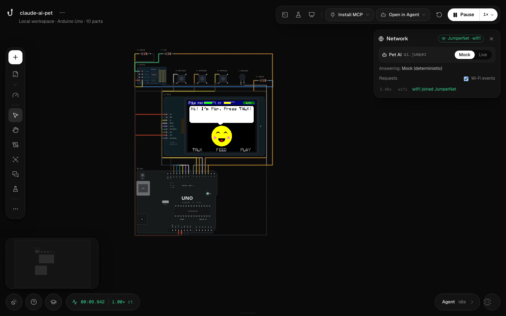

# Status: agents, displays and robots (on top of M0)

Last updated 2026-11-12 (round 12 kit: the build kit, everything to build it yourself; round 11: native builds without Docker; rounds 9-10 integrated: ESP32 / STM32 / nRF52 boards, firmware languages, the device network, docs/boards.md; round 8b: what each case choice costs, thin at a fixed size; round 7: case outlines are fully custom, at any size, and Jumper says
which pieces fit; a DFPlayer + speaker that says things. Round 6: the battery really powers the
board, colour screens in replays and history, clean project switching, canvas controls that work
while it runs, a printable case and a factory pack). M0 is done (below). An agent (Claude Code, Codex, any MCP client) goes from a
one-line goal to a wired, programmed and tested device using only Jumper's tools, and a person
watches it happen on the canvas and in 3D, then runs it themselves.

## Round 12, track kit (2026-11-12): "ask Claude for everything I need to build it"

A person-ready build kit for any project: what to buy, what to print, the tools, how it goes
together inside the case, how to flash it and what to do when it does not work. Branch
`round12/kit`. Guide: [docs/build-kit.md](docs/build-kit.md).

| Area | What works | Check it with |
| --- | --- | --- |
| Tool | `get_build_kit {region?, prefer?, slicer?, write?, pdf?}` (read-only on the project): `{summary, kit, files, next}`; writes `build-kit/<name>-kit/` (kit.html with pictures inside, kit.pdf, KIT.md, SHOPPING.csv / .md, PRINT-LIST.md, the STLs / 3MF / renders, the file to flash, sd-card/) + zip. AGENT_LOOP, AGENTS.md, docs/agents.md name it | `packages/session/test/kit.test.ts` |
| Buy | Every part from the factory BOM with the exact variant (a 250 mAh cell is the 502030 pouch), settings in words with what the module ships with ("Charge current (R_PROG): 250 mA (it usually comes set to 1000 mA ...)"), store links per region (Amazon searches move to .de / .co.uk), prices, alternatives (same-chip boards, "any module sold as"), and rules for what people forget: microSD for a card slot, the mating JST socket for a cell lead (with the polarity warning), a data USB cable per connector type, wire per gauge (metres and colours from the cut list), heat-shrink, solder, Kapton, foam tape, M2 screws + inserts, filament grams. Totals per store, still to buy, and with what they may already have. Lines without a link get store searches and a `no_link` note | same |
| Print | Each STL: material, named colour, face on the bed, supports, layer, infill, grams and minutes from the mesh (documented formula: area x 1 mm solid + infill, 4 mm³/s + 3 s per layer), the 3MF plate, print-service notes (JLC3DP, Craftcloud). PrusaSlicer is used when installed (`JUMPER_SLICER`, cached per STL hash, never bundled); OrcaSlicer detected only | same (fake slicer) |
| Assemble | From the case engine's plan when there is one (`case/assembly/plan.json`, round12/assembly's shape, tested on a real case-6 Muse plan), else derived: print + test-fit, inserts, flash bare, cut list, power and ground first, one module at a time (inline resistors with their module), parts into the case layer by layer (the screen first, which wall each port lines up with), the cell last, close, final check from the scenarios; each with picture, wires (from / to in words, colour, cut, gauge), cautions, a check | same |
| Flash, help | Per backend: UF2 drag-drop, esptool (the board's own command), avrdude / arduino-cli (old-bootloader note), arduino-cli for nRF52 / STM32 (ST-Link / DFU), mpremote; where the file is. Troubleshooting: rules per part category, check_design and case checks, the fidelity "test on the real device" list; tool names turned into people's words | same |
| Factory pack | `build-kit/` added (kit.html, KIT.md, SHOPPING.*, PRINT-LIST.md); the factory files and README.zh-CN unchanged | same |
| HTTP + web | `GET /api/kit`, `POST /api/kit/files`, `GET /api/kit/file`; the Build it panel (Case view "Build it yourself", project menu, phone ⋯ menu): tabs Buy / Print / Assemble / Flash, ticks per viewer in localStorage (try/catch), Zip / PDF / Page, one scrolling sheet with sticky tabs on phones, no tool names | `apps/cli/test/kit-routes.test.ts`, `apps/web/e2e/build-kit.spec.ts` |

Sample (the talking egg of round 8b with its case, firmware built natively): 
`jumper-evals/round12/kit-sample/talking-egg-kit/` (kit.html, kit.pdf, zip). Read as a first-time
maker; fixed what was confusing (see the commit "what a first-time maker tripped on").

Checks (worktree `jumper-wt-r12-kit`, native runtimes, Docker down): `pnpm gen` exit 0, no diff;
`pnpm typecheck` exit 0; `pnpm test` exit 0, **207 files passed, 2 skipped; 1723 tests passed, 5 expected
fail, 5 skipped** (run before the last adapter commit; after it `kit.test.ts`, `kit-routes.test.ts`,
`round6-integration`, `case-tools`: 21/21, exit 0). e2e (`E2E_PORT=6220 E2E_HUB_PORT_BASE=12400
--workers=2`): `build-kit`, `case-view`, `app` on desktop + mobile, 16 passed, exit 0. Earlier
runs had timeouts under a load average of 60 to 165 (other tracks): one real cause fixed (the spec
did not wait for the Projects page, which then covered the panel).

Known gaps (round 12 kit):
- Prices are the part data's typical prices; most links are store searches; no live stock, shipping or tax.
- The derived steps reuse the case renders (the inside render shows unlabelled coloured boxes); per-step pictures come with the assembly plan.
- The assembly plan's own `tools` / `consumables` are not merged into the kit's lists yet (integration).
- Print estimates are not checked against a real slicer here (no PrusaSlicer on this Mac; a fake one tests the path).
- Nothing was bought, printed or soldered from a kit.

## Round 11 (2026-11-11): native builds, firmware and emulators without Docker

Docker Desktop on this Mac is broken (its VM disk has EXT4 errors), so Jumper now builds and runs
firmware natively. Docker stays supported (Linux, CI, or `JUMPER_RUNTIME=docker`). Guide:
[docs/native-runtime.md](docs/native-runtime.md). Branch `round11/native-builds`.

| Area | What works |
| --- | --- |
| Runtime choice | `JUMPER_RUNTIME=auto` (default): Docker when `docker info` answers within 4 s and has the image, else Jumper's native install; `docker` / `native` force one. One probe per 30 s. Nothing usable: what failed, why, and `jumper setup <family>` or start Docker |
| Toolchain | arduino-cli 1.5.1 (SHA-256 checked) in `~/.jumper/toolchains/arduino/1.5.1` with its own data / user dirs: arduino:avr 1.8.8, rp2040 6.3.1, esp32 3.3.12, STM32duino 2.11.0, mbed_nano 4.4.1, Seeeduino nRF52 1.1.13, the libs3 set; the ESP32 set adds the r3 network libraries + JumperEth + JumperSim. The images' post-build steps run natively (RP2040 ihex, ESP32 Wi-Fi/TLS shim + 4 MB flash, nRF52 sim.hex) |
| Emulators | Espressif QEMU 9.2.2 + patches 0001-0003 (bridge v5) compiled into `~/.jumper/emulators/qemu-esp/9.2.2-20260417-jb5` (45 s, 50 MB); Renode 1.17.0 from the release .dmg (SHA-256 checked, 13 s, 180 MB) |
| Setup | `jumper setup` (all) / `jumper setup avr|rp2040|esp32|stm32|nrf52|renode` / `jumper setup list`, with progress; the app: `GET /api/runtime`, `POST /api/runtime/setup` (same lines, NDJSON) |
| Same output | AVR Blink and the RP2040 / libs3 fixtures byte-identical to the Docker builds, except FastLED (a few bytes of register allocation; runs identically, checked on the simulator). ESP32: same image size as Docker's; paths mapped to the image's (`-ffile-prefix-map`), no home folder in firmware |
| Pending fixtures | built natively and run: esp-periph `esp_io` / `esp_bus` on ESP32, S3 and C3 (LEDC PWM, servo, tone, fade, IRQ, ADC raw, I2C on both controllers, Arduino SPI, UART1/2 both ways), `esp_neopixel` (built at test time, LGPL), `net-probe` on the S3 through the device network (2/2), both network examples' scenarios (4/4) |
| Fixes found | servo fixture at 14 bit (the S3 / C3 LEDC maximum); the device-net test's upstream server moved to its own thread (the lockstep loop starved it); run_tests / screenshot now plug an ESP32 into the device network (examples failed "no network card"); native builds set TMPDIR (ctags failed under MCP stdio); unexplained build failures are no longer cached; ESP32 network libraries pinned (PubSubClient 2.8.0, MQTT 2.5.3, ArduinoJson 7.4.3, WebSockets 2.7.2); stale esp32-session expectation; a fake-QEMU cleanup race |

Install (M4 Max): avr 30 s, rp2040 27 s, esp32 92 s, stm32 34 s, mbed_nano 17 s, nrf52 31 s, QEMU 45 s,
Renode 13 s: about 5 minutes and 10 GB in `~/.jumper` (esp32 3.9 GB, stm32 2.2 GB, rp2040 1.1 GB, nRF52 0.9 GB,
mbed 0.5 GB, avr 0.25 GB, libraries 0.4 GB, Renode 0.18 GB, QEMU 0.05 GB). QEMU needs Homebrew's glib,
pixman, libgcrypt, libslirp (`libslirp` was installed for this round: Espressif's 9.2.2 compiles net/slirp.c
even with slirp disabled).

Checks (worktree `jumper-wt-r11-native`, no Docker stub, Docker down):
- `pnpm test`: exit 0, **205 files passed, 2 skipped; 1711 tests passed, 5 expected fail, 5 skipped**. Every
  emulator integration test ran natively: ESP board fixtures, ESP I2C0, MicroPython ESP32 / C3, ESP
  peripherals (MicroPython + the new Arduino fixtures), esp32-session (5/5), device-net firmware (2/2),
  Renode 18/18 + the Black Pill OLED, runner Docker-path tests (AVR + RP2040 byte-identity), libs3 17/17,
  MCP Blink end to end. Skipped: ESP-IDF 2 and PlatformIO 1 (Docker-only toolchains), live AI 2 (keys).
- e2e, full suite (`E2E_PORT=6100 E2E_HUB_PORT_BASE=12100 --workers=2`): 95 passed, 16 skipped, 2 did not run, 1 failed
  (case-view desktop, a text assertion under load; re-run alone: desktop + mobile 2/2 passed). Now running instead of
  skipping without Docker: projects-flow "Build & Run" (native AVR) and renode-board (native Renode), both 2/2 alone.

Gaps:
- ESP-IDF and PlatformIO builds still need Docker (no native toolchain).
- No Docker image was built or run this round (Docker Desktop broken): the Docker path is unchanged and
  unit-tested with a fake `docker`, not re-run for real.
- analogReadMilliVolts is wrong on every ESP chip (no calibration eFuses in QEMU); MicroPython SPI (DMA)
  still fails; ESP32 DevKitC networking not run; native QEMU / Renode are unsigned and QEMU links Homebrew.

## Rounds 9-10, integrated on main (2026-11-11): every board family, one registry, one pipeline

Round 9 spiked the ESP32 family (Espressif QEMU + a Jumper bridge), STM32 / nRF52 boards (Renode)
and a device network. Round 10 ran five tracks on it (esp-app, esp-periph, net, renode, lang); this
merge joins them into one board registry (part.json `mcu` + `availability`), one server-side backend
factory (`@jumper/sim-backends/node`: avr8js, rp2040js, QEMU, Renode), one runner (one Platform table
for every Arduino core, one `BuildResult` for every language) and one support matrix.

**What each board emulates, peripheral by peripheral, with the test behind each cell:
[docs/boards.md](docs/boards.md)** (generated from `packages/parts/src/board-support.ts`; the parts
library shows a board's row, `get_part` returns it as `emulation`).

| Area | Done in this merge |
| --- | --- |
| ESP32 emulator | QEMU patches are a series: 0001 bridge (jb2), 0002 peripherals (esp-periph), 0003 pad pulls + lockstep handshake (esp-app); bridge protocol v5; tag `jumper/qemu-esp:9.2.2-20260417-jb5`. The series applied to clean upstream equals branch `jumper-jb5` of the spike QEMU repo, and it compiles on macOS. `JUMPER_QEMU_ESP_RUNTIME=native` runs a local build. |
| ESP32 backend | esp-periph's pump (stopAt, waveforms, buses) + esp-app's async `prepare()`, why/fix `EmulatorError`, flash padding, pull modes; pad voltages set before boot survive it; network card from the session's device network |
| Renode | the new one-socket Renode backend replaces round 9's ELF adapter in the factory; container labels shared with QEMU (one reaper); native runtime honoured by the runner's checks |
| Builds | ESP32 sketches build with `jumper/arduino-esp32:3.3.12-r3` (Wi-Fi / TLS shim; r2 then r3 built on first use); `purpose: "device"` builds with `JUMPER_SIM=0` for the factory pack; MicroPython / ESP-IDF / PlatformIO through the same `BuildResult` (`format` ihex / esp-flash / elf) |
| Languages | chip families (stm32f103c8 -> stm32f103), Renode loads Intel HEX, MicroPython verified on ESP32 / ESP32-C3 (the filesystem goes after the last partition, as MicroPython 1.24+ expects) |
| Product | `jumper setup esp32` / `jumper setup renode`; the followed page's Run goes to the session for every process board; plan_device never picks a Docker board on its own; Docker that hangs gets its own why / fix |

Checks on this merge (worktree `jumper-wt-r10-main`, branch `main`):
- `pnpm gen`: exit 0, no diff. `pnpm typecheck`: exit 0.
- `pnpm test`: exit 0, **197 files passed, 4 skipped; 1657 tests passed, 2 expected fail, 27 skipped**.
  Run with `JUMPER_QEMU_ESP_RUNTIME=native` (the jb5 sources built natively), native Renode 1.17.0
  and the `docker` command stubbed to fail fast, because **Docker Desktop was hung on this machine
  for the whole merge** (disk filled earlier; containerd I/O errors; every `docker` call hangs; not
  restarted). So the emulator integration tests ran on native emulators, and none ran in Docker:
  - ran: ESP32 board fixtures 5/5 boards, ESP32 I2C0, MicroPython on ESP32 / C3 (GPIO, I2C0 on both),
    ESP32 / C3 peripherals on real firmware (PWM, pin IRQ, UART1, ADC; SPI asserted as a known gap,
    the 2 expected fails), Renode 18/18 (5 boards).
  - skipped (need Docker builds or keys): runner.test 4, libs3 image builds 10, ESP-IDF 2, PlatformIO 1,
    esp32-session 5 (needs an ESP build), device-net firmware 2 (fixture never built), AI gateway / MCP live 3.
- e2e, full suite, `E2E_PORT=5900 E2E_HUB_PORT_BASE=11500 --workers=2`, desktop + mobile + case-costs +
  perf: 94 passed, 17 skipped, 1 failed + 2 did not run (rp2040.spec.ts: `jumper serve` did not start
  within 45 s while a QEMU compile loaded the machine); `rp2040.spec.ts` re-run on desktop + mobile: 6/6
  passed. `renode-board.spec.ts` passed on native Renode.
- Speed (native QEMU, 1.5 s of device time): XIAO ESP32-S3 2.65x real time, XIAO C3 5.05x, C3
  SuperMini 5.73x, ESP32 DevKitC 0.63x, S3 DevKitC-1 2.59x; boot to t = 0 in 37 to 56 ms (no container).

Gaps (rounds 9-10):
- **Docker**: nothing ran in Docker during the merge. Not built: `jumper/qemu-esp:9.2.2-20260417-jb5`,
  `jumper/arduino-esp32:3.3.12-r3` with net's MAC fix, `jumper/arduino-nrf52:1.1.13-libs3-r2`. Until
  the jb5 image is built (`pnpm jumper setup esp32`), ESP boards in Docker fail with "image missing"
  and its fix. After a Docker restart: build the images, re-run `pnpm test` without the stub.
- **ESP32 SPI does not work** on real firmware (C3: MOSI arrives as 00 00; ESP32: the transfer hangs).
  RMT, the S3's peripherals, I2C1 and UART2 are written but unverified; I2S has no QEMU device.
- Arduino-built peripheral fixtures (esp-periph's `esp_io` / `esp_bus` / `esp_neopixel`) and the
  net-probe firmware were never compiled (Docker); the peripheral checks above use MicroPython.
- The ESP session test (build -> run -> export of a XIAO S3) and an ESP e2e did not run (Docker build).
- esp-app's `RemoteRun` (server-paced runs streamed to the page) is not wired into the live hub; the
  followed page runs a fixed 3 s `run` in the session instead. check_design does not read the ESP
  pins' strapping / input-only / ADC2 data yet.
- Renode: Nucleo-F401RE stays planned (attachInterrupt never fires); Nano 33 BLE Serial1 RX never
  delivers; Renode starts on the first step and blocks the server about 2.4 s; no networking.
- Wi-Fi radio and BLE are not emulated anywhere (Wi-Fi sketches ride an emulated Ethernet card).

## Round 10, track net (2026-11-11): the device network, end to end

Generic network access for emulated boards: any API, any protocol over TCP, no feature built for one
use. Branch `round10/net`. Guide: [docs/network.md](docs/network.md); decision
[0007](docs/decisions/0007-device-network-draft.md) (round 10 section).

| Area | What works | Check it with |
| --- | --- | --- |
| Netstack | TypeScript netstack between emulated NICs and the gateway: QEMU `-netdev stream` frames, ARP, DHCP (10.0.2.15, .16 per MAC), ICMP echo, DNS / NTP to the gateway, server-side TCP (window, retransmission, zero-window probe), a switch between boards, a Wi-Fi control channel (EtherType 0x88B5). Runs with the gateway in a worker (`DeviceNetHost`) so lockstep emulators do not starve it | `packages/device-net/test/netstack.test.ts` (frame-level test device: DHCP, DNS, TCP, a 50 kB body through a 2920 B window, TLS with the sandbox CA, blocked hosts, Wi-Fi join / wrong password / unknown SSID / scan / drop / RSSI, the worker host) |
| Firmware | `jumper/arduino-esp32:3.3.12-r3` (`Dockerfile.sim`): simulation builds of sketches that include network headers link JumperSim: `esp_wifi_*` wrapped onto the emulated Ethernet card (WiFi.begin / status / localIP / RSSI / scan, events, auto-reconnect unchanged) and mbedTLS chain verification wrapped to also trust the sandbox CA (sent by the netstack at join). Same source as the device; `JUMPER_SIM=0` builds without. PubSubClient, arduino-mqtt, ArduinoJson, WebSockets pinned in the image | real ESP32-C3 run (below) |
| Product | jumper.json `network` (mode, allow, secret names, mocks file, cassette, Wi-Fi); tools `read_network`, `add_mock_api`, `inject_network_fault` (+ `weak_signal`), `set_network`, `try_request`; scenario steps `request` / `network_fault` (run_tests forces mock mode, counts per scenario); firmware/NETWORK.md in the factory pack; fidelity note; delays and log times on the simulation's virtual clock; `QemuEspBackend {network: {framePort, mac}}` and `session.networkFor(n)` | `packages/session/test/network-tools.test.ts`, `packages/device-net/test/vclock.test.ts` |
| Network panel | Rail → Network (phone menu → Network): Wi-Fi state, mode, secrets by name (set / missing), requests with status / source / time / TLS / secret names, WS and MQTT sessions summarized, Wi-Fi / DHCP / DNS events, blocked with why and fix; Drop Wi-Fi / Weak signal / Clear faults; a Try box (`GET /api/network`, `POST /api/network/fault`, `POST /api/network/try`) | `apps/web/e2e/network-panel.spec.ts`, `apps/web/src/views/network/devnet.test.ts` |
| Examples | `examples/esp32-api-demo` (XIAO ESP32-S3 + SSD1306: HTTPS JSON from Open-Meteo with the real root CA, replayed from a real recorded cassette; MQTT publish to a mock broker; Wi-Fi drop and 503 scenarios) and `examples/esp32-ws-stream` (XIAO ESP32-C3, 40 binary chunks over wss://) | need the ESP32 boards from round10/esp-app (see gaps) |

Real firmware (earlier in this round, before Docker failed): the `wifi-https` fixture, a plain
WiFi.h sketch with the ISRG Root X1 CA set, built with the r3 image for the ESP32-C3 and run
free-running in `jumper/qemu-esp` with its NIC on the netstack: scan finds "JumperNet", joins,
DHCP 10.0.2.15 / gw 10.0.2.2, DNS → 198.18.0.1, HTTPS GET to a mock → 200 with the body (mbedTLS
accepted the sandbox CA through the shim; 1.0 to 1.4 s virtual, handshake included), a blocked host
→ NXDOMAIN with why / fix, weak_signal → `WiFi.RSSI()` -82, wifi_drop → status 5 then 1 with
refused joins counted, clear → rejoin, DHCP, fetch again 200. Run three times, same outcome.

Checks (worktree `round10/net`): `pnpm gen` no diff; `pnpm typecheck` exit 0; `pnpm test` exit 0,
1436 passed, 26 skipped (176 files) with the `docker` command stubbed to fail fast, because Docker
Desktop stopped answering (below); e2e `network-panel` + `projects-flow` on desktop and mobile
(`E2E_PORT=5840 E2E_HUB_PORT_BASE=11200`): 7 passed, 3 skipped by design, exit 0.

Known gaps (round 10 net):
- **Docker Desktop hung** mid-round after the disk filled up (I/O errors in its containerd store,
  then every `docker` call hanging for over an hour; not restarted, other tracks share it). Not run
  because of it: the committed `test/firmware.integration.test.ts` (ESP32-S3 in lockstep through
  `DeviceNetHost`: secret injected and masked, MQTT, drop + reconnect; it skips until
  `fixtures/net-probe.esp32s3.merged.bin.gz` is built, see fixtures/BUILD.md), the r3 image rebuild
  with the MAC fix (the r3 tag on this machine predates it), and compiling both examples. The
  WebSockets example (`beginSslWithCA`) and the S3 build were never compiled.
- **Examples need round10/esp-app**: they use its `seeed-xiao-esp32s3` / `seeed-xiao-esp32c3` parts
  and its session wiring for ESP32 boards. On this branch alone they list with unknown parts. After
  the merge: set `ESP32_IMAGE` to `jumper/arduino-esp32:3.3.12-r3` (build it from `Dockerfile.sim`)
  and pass `network: await session.networkFor(n)` instead of `network: false` to `QemuEspBackend`
  when `project.network` is set.
- **OLED on the S3**: QEMU's S3 machine has no I2C controller model (round 9), so the demo's display
  stays blank unless another track adds it; the firmware says `oled not found` and keeps working.
- Not emulated: the Wi-Fi radio (signal, range, roaming, power save), soft-AP clients, ESP-NOW,
  BLE; UDP other than DNS / NTP; IPv6; MQTT secrets in CONNECT; QoS 2. Renode boards have no NIC
  (not connected; docs/network.md says what it would take).
- Timing through the network is not bit-exact (frames cross a socket while QEMU is parked);
  outcomes are deterministic in mock and cassette modes.

## Round 10, languages track (2026-11-11): firmware languages beyond Arduino, as one mechanism

Branch `round10/lang` (on `round9/spike`). `firmware.language` + a toolchain per language per chip +
one output rule per chip ([docs/firmware-languages.md](docs/firmware-languages.md), the matrix).

| Area | What works | Check it with |
| --- | --- | --- |
| MicroPython on RP2040 | Official MicroPython 1.29.0 (RPI_PICO bundled, SEEED_XIAO_RP2040 downloaded + SHA-256) + a littlefs image with the project's `.py` files, built in process (no Docker), as one Intel HEX; boots on rp2040js, runs main.py, Pin / hardware I2C on the board's bus, REPL in the Serial panel; syntax errors (mpy-cross) and tracebacks at file:line | `services/runner/src/lang/lang.test.ts`, `packages/session/test/languages.test.ts`, `apps/web/e2e/micropython.spec.ts` |
| Mechanism | `firmware.language` in the schema, `set_firmware` tool / `jumper firmware`, starters, templates `pico-micropython`, `pico-micropython-oled`, `uno-platformio`, `plan_device` proposes a language, `run {serial_write}` and `run.errors`, `jumper setup <language>` | same |
| Web | Python mode in the code editor, tabs show paths (main/main.c), the Serial panel has a send line (REPL, `Serial.read()`), language-aware build status, runtime errors at their line | `e2e/micropython.spec.ts` |
| ESP-IDF, PlatformIO | Images `jumper/esp-idf:5.5.5-r1` and `jumper/platformio:6.2.0-avr5.3.0-r1` built; builders and Docker tests written; **not verified**: Docker Desktop's disk failed mid-round | `espidf.integration.test.ts`, `platformio.integration.test.ts` (skip without the images) |
| Fix | RP2040 backend: an output pin's input register reads its own level (as on the chip) | `lang.test.ts` |

## Round 8b (2026-11-11): Jumper says what each case choice costs, and steers to thin

Evidence: a real Claude rebuilt the talking egg on round-8 code and got 74 x 96 x 44.4 mm, worse
than round 7's 34.3 mm, with small parts. Its own case choices made it thick (a 6 mm dome on both
faces, the eyes and the speaker pinned on the front with `y_mm`, a fixed 74 x 96 mm size after
60 x 78 failed, where "balanced" picked round 7's 3-layer stack), and Jumper never said what they cost.
One branch (`round8b/costs`), merged into main.

| Area | What works | Check it with |
| --- | --- | --- |
| Choice costs | `check_fit`, `propose_layout`, `design_case`, `update_case` return `costs`: for each choice (a placement's x / y, layer, face, on_edge; dome over 1.5 mm; numeric edges; a fixed w / h or d; wall over 1.6; gap over 1.5; screws) the light proposal search runs again with it relaxed, and with all relaxed (`relax_all`); each says what it adds (thickness, length, cm³) with the `update_case` call that relaxes it, e.g. "A 6 mm dome on both faces adds 9 mm of thickness (37.2 -> 28.2 mm thick with a 1.5 mm dome). Fix: update_case {\"params\":{\"dome_mm\":1.5}}". Time-boxed (10 s; check_fit 5 s), what is not reached is `skipped`. `next` names the costliest | `packages/enclosure/test/costs.test.ts`, `packages/session/test/round8b-costs.test.ts` |
| Steer to thin | At a fixed w / h the optimizer goes deeper until a layout fits (and searches a slightly smaller outline when the finished case pokes out); balanced = the thinnest that fits that outline. A dome over 3 mm a face is a `dome` warning with what it adds. A speaker pinned on the front is weighed against its grille on the back. A fixed size that fails names the choice that breaks it and `sizes_that_work` (flat and stacked) | same |
| Case view | Layout tab, "What's making it bigger": each costly choice in plain words (no tool names) with an Apply button, "Let Jumper decide all of these", the sizes a failing fixed outline works at (`POST /api/case/costs`) | `e2e/case-costs.spec.ts` |
| Agent guidance | Tool descriptions (the design_case example no longer shows `dome_mm: 3`), MCP server instructions, AGENTS.md and `plan_device`'s plan for held devices: do not pin unless the person asked, dome and edges on auto, `propose_layout` before `design_case`, read `costs` and relax the costly ones, aim for 20 mm or less for a pocket device | `round8b-costs.test.ts` |
| Window bug | The red in round 8's exploded egg was the speaker seen by parallax: the front shell moved 20 mm out, the screen stayed behind. The screen-window check only compared sizes. Now it looks through the window (rays must land on the display's active area; a window off the screen, a part in front or nothing behind fail, naming what is seen), and the parts the front shell holds move out with it in the exploded render and the web explode. Engine `case-5`; the Muse example regenerated (same size) | `packages/enclosure/test/sight.test.ts`, `engine.test.ts` |

The talking egg, end to end (lead, in process through `ProjectSession`, not port 7780): round 8's
`talking-egg-2/jumper.json` copied to a temp folder.

| Egg | Size | Layers | Volume | Checks | Notes |
| --- | --- | --- | --- | --- | --- |
| Round 8 as the agent built it | 74 x 96 x 44.4 mm | 3 | 218.8 cm³ | all ok | round 7's stack at a fixed size |
| As-is, round 8b (same choices) | 74 x 96 x 37.2 mm | 3 | 181.1 cm³ | all ok, `dome` warning (+10.1 mm) | `design_case` 68 s; costs 8.2 s: the fixed size adds 10 mm (93.8 x 122.2 x 27.2 at auto), the dome 9 mm; relax_all 84.8 x 110.5 x 18.5; both pins, the speaker face and the switch face cost nothing alone |
| After the agent applies the top costs (dome 1.5, size auto, eyes pin dropped; each checked with propose_layout first) | 81.7 x 106.5 x 20.2 mm | 2 | 130.6 cm³ | all ok (fits, watertight, no-intersection, min-wall, size-match, screen-window 35 / 35 lines of sight, both USB) | `update_case` 54 s; pocket "no" (106.5 x 81.7 across, over 70 mm wide) |

Renders, report and log: `jumper-evals/round8b/proof/` (outside the repo), looked at: the screen is
dark behind its window in the front, exploded and inside renders.

Checks (worktree, before the merge): `pnpm gen` no diff; `pnpm typecheck` 0 errors; `pnpm test`
1414 passed, 2 skipped, 0 failed (166 files; earlier full runs each had one load timeout, in
`visual-capture` or the CLI test, both passing alone; the CLI test got 30 s). Full e2e (desktop,
mobile, perf and the new `case-costs` project, `E2E_PORT=5700`, hub ports from 10600): 92 passed,
16 skipped by design, 0 failed, exit 0, with `--workers=1`. Not first time: five earlier full runs
at the default 3 workers (2 once) had 1 to 3 failures each, different specs every time (rp2040
follow, power-usb, switch-projects, voice mute, case-outline, case-layout), each passing when re-run
alone, while the machine's load average was 14 to 39 (other processes). Two real causes found and
fixed on the way: the costs blocked jumper serve for seconds (now they give way between searches,
and the Case view's own saves skip them), and a case spec's jumper serve kept running in CAD after
SIGTERM (now killed); the `case-costs` spec runs alone after the others.

Known gaps (round 8b):
- **Costs** relax one choice at a time and all at once: two choices that only cost together show
  only in `relax_all`. They use the light search (a few tenths of a mm from the built case). On a
  loaded machine the 10 s box can skip choices (`skipped`). The Case view weighs the saved case only
  (not a dragged draft); each search still holds the server for about 1 to 2.5 s (they give way
  between searches).
- **Fixed sizes**: the deeper search at a fixed outline takes 1 to 2.5 s; the shrink retry rarely helps.
- **The egg** at 81.7 x 106.5 x 20.2 mm is still not "pocket" (over 70 mm wide); the speaker stays
  pinned on the front in the proof (its pin cost nothing alone).
- **e2e**: a clean full run needed `--workers=1` on this loaded machine (see above); the suite is
  heavier by one spec (about 6 minutes of CAD).
- **Not checked**: a live Claude Code run over MCP with the new guidance; print and hand feel.

## Round 8 (2026-11-11): Jumper works out how the parts go inside, and shows it

The person saw the talking egg a real Claude built (78.2 x 102 x 34.3 mm, "bulky", though the parts
are only about 23 cm³) and asked for Jumper itself to work out the best way to distribute the parts,
and to propose or show it, for any custom shape. Three tracks merged into main (layout-engine, then
parts-advice, then view; no textual conflicts).

| Area | What works | Check it with |
| --- | --- | --- |
| Distribution optimizer (track engine) | Flat first, then 2 or 3 layers, inside the real outline; three proposals (thinnest / smallest / balanced) with `why`, layers, placements, fill ratio and front / side views; `enclosure.layout` picks one (auto = balanced); pins kept. Talking egg: balanced 97.6 x 127.3 x 23 mm, thinnest 21.5 mm, all checks ok (the `dome_mm: 3` costs 6 mm). Tool `propose_layout` (55 tools), `POST /api/case/layouts`. Engine `case-4` | `packages/enclosure/test/optimize.test.ts`, `packages/session/test/round8-layouts.test.ts` |
| Smaller parts (track parts-advice) | check_design says which parts a device may not need (`boost-not-needed`, `smaller-speaker`, `combine-charge-boost`, `board-bigger-than-needed`, `charger-not-needed`) with the mm; new parts `speaker-20mm`, `speaker-15mm`, `charge-boost-5v`; `plan_device` compact plans and `size_budget` | `packages/session/test/parts-advice.test.ts` |
| Case view Layout tab (track view) | The three proposals as cards (front view + side cross-section with mm, thickness, pocket badge, fill %, why); select = 3D preview (labelled boxes in the see-through shell); Use builds it; "built" on the layout the case uses (the person's or an agent's); Re-distribute when the built case is older or another way is found. Drag a part (or arrow keys) to keep it there: the rest re-arranges live with the new size; a drop on a part that stays put, or a spot the rest cannot fit around, is refused with the reason. Parts you may not need, with mm saved; Apply for the 20 mm speaker swap and an unneeded boost (remove + place_part + connect as one undo step; `GET /api/case/advice`, `POST /api/case/advice/apply`) | `e2e/case-layout.spec.ts`, `packages/session/test/advice-notes.test.ts`, `packages/enclosure/test/pin-roundtrip.test.ts` |
| Fixes found on the way (track view) | Each proposal placement carries `pin` values (Layout records its centring shift); the optimizer crashed when every part was pinned and never recovered from a first state that did not fit (2+ pins usually broke the layout); `update_case` removes a placement field set to null; the Case view used a 14-point copy of an agent's SVG outline for its previews and called the case changed (or an ellipse before the case was first built) | same tests |

Checks after the merges (main, local): `pnpm gen` no diff; `pnpm typecheck` 0 errors; `pnpm test`
1380 passed, 17 skipped, 0 failed (163 files; the skips are toolchain tests while Docker is down,
not re-checked one by one). e2e (desktop + mobile, `E2E_PORT=5640 E2E_HUB_PORT_BASE=10400`):
`case-layout`, `case-view`, `case-outline`, 6 passed. Full e2e on main after the merges (desktop,
mobile and perf, `E2E_PORT=5660`, hub ports from 10500): 90 passed, 17 skipped by design, 0 failed,
exit 0, first run. Decision note [0005](docs/decisions/0005-round8-auto-layout.md).

The talking egg, end to end with the merged code (lead, through `ProjectSession`, no server, not
port 7780): round 7's `talking-egg-2/jumper.json` copied to a temp folder, the agent's outline,
`dome_mm: 3` and pins kept, auto size, auto layout.

| Egg | Built case (balanced) | Volume (shell) | Fill | Pocket | Checks | Other proposals |
| --- | --- | --- | --- | --- | --- | --- |
| Round 7 as built | 78.2 x 102 x 34.3 mm, 3 layers | 201.5 cm³ | | no | all ok | |
| As-is, round 8 | 97.6 x 127.3 x 23 mm, 1 layer | 204.4 cm³ | 0.18 | no | all ok (`design_case` 67 s) | thinnest 100.7 x 131.3 x 21.5; smallest = round 7's stack |
| After the parts advice (Apply: boost removed, `sw.1` → `d1.A`; 20 mm speaker; check_design 0 errors, no notes left) | 79.6 x 103.8 x 28.8 mm, 2 layers | 171.4 cm³ | 0.14 | no | all ok (`design_case` 127 s) | thinnest 111.4 x 145.2 x 21.5 |

Renders (front / back / exploded / inside, report.json, log.json, jumper.json):
`jumper-evals/round8/integ-renders/{asis,advised}/` (outside the repo), checked by eye: one layer
with lots of empty room in the as-is egg; the advised egg stacks the cell behind the screen, the
20 mm grille is a hex field in the back shell.

What the pins cost (propose_layout only): without the agent's `y_mm` pins (faces kept) the advised
egg lays flat at 84.7 x 110.4 x 21.5 mm for all three goals; the as-is egg at 95.7 x 124.8 x 21.5
(thinnest) or 84 x 109.5 x 26 (balanced). With the default dome instead of `dome_mm: 3`, the same
are 17.5 mm thick. The egg never reaches "pocket": the footprint stays over 110 x 70 mm.

Known gaps (round 8):
- **Pins:** an agent's early `y_mm` pins can make the flat layout much bigger (advised egg
  111 x 145 vs 85 x 110 mm without them), and removing parts can then make the thinnest proposal
  larger. Jumper does not yet say what a pin costs or offer to drop it.
- **Search quality:** heuristic, not an optimum; fill ratios 0.12 to 0.19 on the egg. Presets keep
  round 6's full stacker search (2 to 5 s); a 15-part project was not timed.
- **Proposal vs built volume:** a proposal's `volume_cm3` is the outline-box estimate (egg 223.9),
  the report's is the real shell (204.4).
- **Parts advice:** Apply covers only the smaller speaker and an unneeded boost; the 8 mm DFPlayer
  sets the thickness floor; the IP5306 module size is a typical figure, no LCSC numbers;
  `charger-not-needed` never fires on today's catalog; 20 / 15 mm speaker loudness is a judgement.
- **Case view:** on mobile the 3D egg is partly under the overlays; labels on tiny parts do not show
  in the 2D views; the "goes back" path after a bad drop has no unit test.
- **Not checked:** the 17 skipped unit tests one by one (Docker down); `variants/puck` of the Muse
  still at the old engine; a live Claude Code run over MCP; print, plastic and hand feel.

## Round 7 (2026-11-10): any case outline, and a part that talks

The person asked for "the shape of an egg, with eyes and a speaker to say stuff", and then made it
clear that an egg is only an example: a case should be any custom shape at any size, with Jumper
working out which pieces fit. Two tracks merged into main (shape, then voice; no textual conflicts),
then the lead's integration. There is no "egg" preset on purpose: `shape: "custom"` takes any outline
the agent draws.

| Area | What works | Check it with |
| --- | --- | --- |
| Custom outlines (track shape) | `shape: "custom"` + `enclosure.outline` (SVG path, y down, or `{points, smooth}`, y up) + `size_mm {w,h,d}` (each optional, blank = auto). Outline checks (closed, one shape, no self-crossing, ≤ 8:1, ≥ 3 points; narrow-neck warning) say what, why and fix with the position. One periodic B-spline drives both OpenCascade and the packer, so what is checked is what prints. Parts pack inside the real outline, inset by wall, wiring room and rim round-over at their depth. Auto grows the outline to the smallest size that holds the parts (15 to 250 mm); a fixed size stays exactly that size. Finish params (`edge_radius_front_mm`, `edge_radius_back_mm`, `dome_mm`, `dome_back_mm`, `depth_mm`) on every shape; `placements.on_edge`; a LiPo's `capacity` picks a typical pouch. Engine `case-3` (old cases regenerate on their next `get_case`) | `packages/enclosure/test/custom.test.ts`, `custom-cad.test.ts`, [docs/enclosures.md](docs/enclosures.md) |
| Rethink the pieces (track shape) | A fixed size that is too small: `design_case` / `update_case` return `fits: false`, `saved: false`, `misses` (part, mm short, where) and `suggestions` (a smaller part in the same role, a smaller LiPo cell, a part on its edge, flatter rims, or "make it N mm bigger"), each tried with the same layout and listed as the tool calls that make it. Nothing is saved. New tool `check_fit` (= `design_case {dry_run: true}`, `POST /api/case/fit`) answers in about a second without CAD | `packages/session/test/case-fit.test.ts`, `round7-integration.test.ts` |
| Outline editor (track shape) | Case view: Custom shape opens an editor (start from ellipse / pebble / puck / pill / box; drag, add, remove points, keyboard too), W / H / D inputs, a live real-size preview with the parts' footprints, red where one hits the wall, and a "Use N × M mm" button | `e2e/case-outline.spec.ts`, `e2e/case-view.spec.ts` |
| Voice (track voice) | `dfplayer-mini` (all 16 pins, the serial protocol with checksums, online / ACK / track-finished replies, BUSY, start-up timing, bad frames warned) and `speaker` (8 / 4 Ω, overpower, an 18 mm round grille feature the case cuts). Clips are a new `text` prop ("N: words"). A played track is an utterance in virtual time (words / 2.6 per s + 0.3 s), heard only when a speaker is wired. AVR hardware Serial (D0 / D1) now reaches parts that listen; RP2040 Serial1 already did. Scenario step `said`, tool `read_speech`, `run` returns `said`; check_design `dfplayer-no-speaker`, `dfplayer-no-words`, `dfplayer-bad-clips`, `dfplayer-spk-shorted`, `speaker-on-pin`. `plan_device` picks DFPlayer + speaker + 1 kΩ for talk / speak / say / voice goals. The factory pack writes `sd-card/` (clip texts, `make-clips.sh` for espeak-ng or piper + ffmpeg, which the user installs: see NOTICE). Web: a speech bubble on the speaker, the browser's own voice with a remembered mute. Example `examples/talking-egg-demo` (2/2 scenarios) | `packages/parts/src/parts/dfplayer-mini/model.test.ts`, `packages/session/test/voice.test.ts`, `e2e/voice.spec.ts` |
| Integration (lead) | Merged both; regenerated `docs/mcp-tools.md` (54 tools). Fixed what the merge broke: the Projects home now lists 7 examples (the talking egg among them; `projects-flow.spec.ts` expected 6). `plan_device` maps "eyes" to a screen (the person's own words had picked no display). A load-flaky unit test (`visual-capture` deterministic scrubbing) got 30 s like its neighbour. New `packages/session/test/round7-integration.test.ts`: the person's sentence through `plan_device`, and the REAL voice parts in an egg the agent draws | `packages/session/test/round7-integration.test.ts` |

Checks after the merge (main, local): `pnpm gen` no diff; `pnpm typecheck` 0 errors; `pnpm test`
1325 passed, 2 skipped, 0 failed (155 files; the first run after the merge had 1 timeout in
`visual-capture`, fixed above); full e2e (desktop, mobile and perf, `E2E_PORT=5560`, hub ports from
10100) 89 passed, 16 skipped by design, 0 failed, exit 0. The first full e2e run after the merge had
86 passed, 2 failed (`projects-flow` desktop + mobile: the new example; a real failure, fixed).

The talking egg, end to end with the merged code (lead, through `ProjectSession`, no server):
XIAO RP2040 + GC9A01 eyes + DFPlayer Mini + speaker + 1 kΩ + 500 mAh LiPo + TP4056 + slide switch +
1N5817, in an egg drawn as an SVG path (`dome_mm: 2`, auto size). `check_fit` fits in about 1 s;
`design_case` (68 s) made 63.9 × 83.4 × 37.3 mm, 143 cm³, `ok: true`, every fit check ok (fits,
watertight, no-intersection, min-wall 1.6 mm, size-match, screen window Ø33, both USB ports
reachable, printable with a rim-overhang warning). The speaker grille is a hex field of holes in the
back shell. Pocket verdict: **no** (37.3 mm thick, bulky). At a fixed 60 × 78 mm the parts do not
fit (switch 2.6 mm, charger 2.3 mm, screen 1.8 mm over) and the suggestions are: flatter rims (fits
at 60 × 78), a 150 or 250 mAh cell (61.2 × 79.5), the SSD1306 instead of the GC9A01 (63.3 × 82.3),
or 64.1 × 83.3 mm. At 44 × 57 only "flatter rims" and "bigger" are offered (no single swap gets
close). Renders and the full case: `jumper-evals/round7/integ-renders/` (outside the repo).

Known gaps (round 7):
- **Thickness:** the talking egg is 35 to 37 mm thick at any outline size from auto up to about
  70 × 91 mm, with any rim radius; only around 90 × 117 mm does the packer lay the parts out in
  fewer layers (20.8 mm). The packer is a heuristic, not an optimum; suggestions change one thing at
  a time, and a depth miss on a fixed `d` offers only "bigger" when no part in the library is
  thinner in that role (there is one speaker and one MP3 module).
- **Fit preview vs CAD:** presets at auto size keep the round-6 search, so their quick preview can
  differ slightly from what `design_case` makes; custom outlines and fixed sizes share one search.
- **Outlines:** ports on curved outlines can need a local flat (≤ 8 mm, warned), never on a fixed
  size; the heart's rim rounds 2 to 6 mm where OpenCascade cannot fillet the full radius; saving an
  agent's SVG outline in the editor turns it into points; the "failed to compute a normal" message
  still prints.
- **Voice:** not emulated: ADKEY / IO buttons, EQ, loop, adverts, real MP3 length and voice, FAT copy
  order. `make-clips.sh` has not been run here (no espeak-ng / piper / ffmpeg). No LCSC numbers for
  the DFPlayer or speaker. The browser voice speaks a clip again on each new utterance in a replay
  or follow view; the bubble on a followed page and in replays has no e2e. The real browser voice
  was never heard (tests block it on purpose).
- **Not done:** decision note for round 7; a live Claude Code run over MCP building the egg (the
  integration above drives the same tools in-process); the print, plastic and hand feel.

## Round 6 (2026-11-10): a real device (battery, colour replays, project switch, canvas controls, case and factory pack)

Five tracks merged into main in the order power, frames, switch, canvas, case (decision
[0004](docs/decisions/0004-round6-real-device.md)), then the lead's integration. Checks after the
merge: `pnpm gen` no diff, `pnpm typecheck` 0 errors, `pnpm test` 1229 passed, 2 skipped (139 files); full e2e (desktop,
mobile and perf, `E2E_PORT=5360`, hub ports from 9400) 77 passed, 14 skipped by design, 3 failed (case view desktop + mobile, switch-projects; an earlier version of this line wrongly called them flaky). All three were fixed in round 6b, below.

The Pocket Muse (`examples/agent-built/claude-pocket-muse`, Claude Code's round-5 build) now goes
the whole way: its LiPo really powers it (USB unplugged, switch + 1N5817, 11/11 tests, check_design
0 errors and one honest `ldo-dropout` warning), its replay and History show the round screen in
colour, and its pebble case (65.9 × 73.6 × 24.7 mm, fits a pocket, every fit check ok) plus a puck
variant (63.1 × 55.2 × 32 mm, tight) open in the Case view, from which the factory pack is one click.

| Area | What works | Check it with |
| --- | --- | --- |
| Power (track power) | Boards have a supply chain: USB on VBUS / 5V when `power.usb` is not false, their own LDO / Schottky / buck-boost, their own current; firmware is held in reset without power and boots again when it returns. 7 new parts (1N5817, 1N4148, AO3400, 2N2222 / BC547, 2N2907 / BC557, MCP1700 / AP2112, MT3608). check_design: `usb-backfeed`, `battery-reversed`, `battery-overvoltage`, `ldo-dropout`, `no-power-path`, `diode-reversed`. `set_power`, `set_assembly`; soldered exports (WIRE-CUTS.csv, ASSEMBLY.md, no breadboard / dupont). search_parts with no fit returns a `create_part` template; get_part resolves short ids. Web pill: USB switch and the battery reading | `packages/sim-core/src/power.test.ts`, `packages/session/test/power-*.test.ts`, `e2e/power-usb.spec.ts`, [docs/power.md](docs/power.md) |
| Colour frames (track frames) | `run` / `run_tests` log changed TFT / round screens as PNGs (`Frame.color`, ≤ every 100 ms virtual, thinned to 120 images / 1.5 MB per entry). Replays, live follow, `record` videos, History previews and gallery thumbnails paint them. libs3 toolchain images add Adafruit GC9A01A, DHT, FastLED, TFT_eSPI, NeoPixel (LGPL, user firmware only); all 41 golden hexes rebuild byte-identical | `packages/session/test/color-frames.test.ts`, `e2e/frames-color.spec.ts`, `packages/parts/src/libs3.integration.test.ts` |
| Project switch and history (track switch) | Opening a project resets the old one (sim, hex, code card, toasts, captions, tests, History, editor): no false "built for another board". An opened example is a restorable version; History shows `+N −M` lines and "built" only where the code matches; the person's own edits are never pending agent steps; a newcomer lands on Projects; thumbnails drawn at start; `run` says "ran the device for 3 s" | `apps/cli/test/switch-history.test.ts`, `e2e/switch-projects.spec.ts`, [docs/projects.md](docs/projects.md) |
| Canvas controls (track canvas) | Click a running button's cap to press it (≥ 120 ms wall and virtual); body / label still drag; knobs turn; dragging an IMU tilts it; Shake held or timed on virtual time; docked Live controls card with Use / Arrange; serial follows the newest line; the view stays where the person put it; short-id labels; Inspector wiring follows the board (XIAO SDA → GP6) | `e2e/canvas-controls.spec.ts`, [docs/try-it.md](docs/try-it.md) |
| Case and factory pack (track case) | `design_case` / `update_case` / `get_case` / `export_manufacturing` (MCP, CLI by name, HTTP): five shapes, snap or M2 screws, lanyard tab, belt clip; STL, coloured 3MF, STEP, renders, A3 drawing, print notes; fit checks (watertight, no intersection, wall, size, screen window, button travel, USB access, overhangs, pocket). Factory pack: supplier README + zh-CN summary, BOM with MPNs, wiring, netlist, KiCad netlist, wire cuts, firmware with flashing steps, case files, assembly steps with renders, test plan, checksums, zip. Web Case view with see-through / explode, settings, checks, downloads, factory pack. `mechanical` + `sourcing` data on the parts | `packages/enclosure/test/*`, `packages/session/test/case-tools.test.ts`, `apps/cli/test/case-routes.test.ts`, `e2e/case-view.spec.ts`, [docs/enclosures.md](docs/enclosures.md) |
| Integration (lead) | The factory pack's wire cuts use the power track's `wireCuts` with pin positions from the case layout (×1.3 routing + strip + slack); the Muse re-cased after its re-wire and run again so its log has colour frames; the Case view lists `save: false` variants with downloads; `get_part` adds `wiring_on_this_board` for the project's board; `plan_device`'s last step and the agent loop (MCP instructions, AGENTS.md, docs/agents.md) end with `design_case` → `export_manufacturing` when the person wants a real device; a tool called without a part id says to pass `id` (was an internal error) | `packages/session/test/round6-integration.test.ts`, `apps/cli/test/case-routes.test.ts` |

Known gaps (round 6):
- **Power:** not modelled: regulator current limits and thermal shutdown, inrush, gradual brownout;
  diodes and transistors are piecewise-linear; the Uno does not switch between USB and VIN by
  itself; the web USB toggle changes only the local project and the running sim (a followed page
  says to ask the agent; no route for `set_power`); the `run` summary does not say "no power" (the
  `board-unpowered` diagnostic does). Battery figures are typical values.
- **Case:** packing is a heuristic, not optimal; parts without mounting holes are held by ribs or
  foam tape; the pebble keeps a near-square edge where a USB port sits near the back; no IGES (STEP
  AP214 only); wire cuts are straight-line distances × 1.3, not routed; LCSC / JLC numbers empty
  until checked; 3 to 20 s per case; the factory pack holds the saved case only (variants stay in
  `case/variants/`); the Case view needs `jumper serve`. The print, the plastic, snap strength and
  the hand feel are not tested. The resistor and the robot chassis have no `mechanical` block (not
  needed by any shipped case).
- **Colour frames:** runs logged before round 6 stay dark in History; FastLED on RP2040 sends a few
  bits at 0.216 µs (the strip reports it); TFT_eSPI is RP2040 only; a replay's clock shows the time
  of the last change, not the end of the run; NeoPixel has no committed binary (LGPL).
- **Switch / canvas:** a Projects page open at first load still renders the canvas under it; copying
  an example does not tell an open live page about its new version 1 until History opens; on phones
  the panel column can show more than one panel.
- **Muse example:** its round-6 calls (tests, a run, design_case, export_manufacturing) were made
  with the CLI by the lead, not by the agent, and are in its log as actor `cli`.

### Round 6b (2026-11-10): real-device evidence fixes (case, UI, e2e)

Three tracks from the round-6 evidence (a real Claude case build and a first-timer's think-aloud,
in `jumper-evals/round6/`) merged into main in the order case, ui, e2e, then e2e hardening. Checks
after the merge: `pnpm gen` no diff, `pnpm typecheck` 0 errors, `pnpm test` 1246 passed, 2 skipped
(145 files); full e2e (desktop, mobile and perf, `E2E_PORT=5460`, hub ports from 9900, Playwright's
own exit code 0) 83 passed, 0 failed, 16 skipped by design, 0 flaky (no retries locally). The
machine ran at load average 55 to 110 during these runs; four earlier full runs each had 1 to 3
load-sensitive failures, fixed in the tests (see the last row).

| Area | What changed | Check it with |
| --- | --- | --- |
| Case (track case) | Pebble, pill and puck are rounded in 3D (one large fillet per rim, sized from the side openings), the pebble's faces domed ~1 mm with flat print pads; each USB port gets its own side on curved shapes; a packing search (4 part orders × 11×11 plan sizes) keeps the smallest outer volume; pocket verdict by thickness (≤ 18 mm within 110×70 fits, ≤ 22 mm within 130×80 tight, else bulky); `report.volume_cm3`. STLs in print orientation on z=0; `case.3mf` is one laid-out build plate. Part values ("100k", "1uF", "500mAh") in BOM.md / BOM.csv / KiCad netlist / WIRING.md. Case view: instant tooltips, "Designing…" / "Updating…", readable loading text, sticky close, missing items say what to press. Engine `case-2`. Muse pebble now 70.7 × 94.3 × 19.6 mm, 97 cm³, tight; puck 72.7 × 72.7 × 25 mm, bulky | `packages/enclosure/test/*`, `packages/session/test/part-values.test.ts`, `packages/session/test/factory-firmware.test.ts`, `e2e/case-view.spec.ts`, [docs/enclosures.md](docs/enclosures.md) |
| UI (track ui) | The person's own changes (code edits, restores, Update case, drags) are their own accepted steps, never pending agent steps; old pending ones are settled on load. One firmware freshness answer from the source hash (CRLF / library order ignored); a copied example adopts its shipped hex, so no false "sketch changed". Opening an example again reopens your copy; "New copy" makes "Name (2)". Cards keep their order; End / Home / PageDown scroll Projects. A just-opened project shows the device off at 00:00.000. Serial filter box (words, `-word`). The Muse gets dizzy from Shake (the shake loops with a wrist turn); a keyboard-friendly Shake length picker | `packages/session/test/person-steps.test.ts`, `apps/cli/test/reopen-copies.test.ts`, `e2e/switch-projects.spec.ts`, `e2e/canvas-controls.spec.ts` |
| e2e (track e2e) | Closing the code editor right after Save waits for the save instead of asking to discard it (a real bug behind the switch-projects failure). Projects page has a labelled "← Back to <project>" button (icon only for "New project" on phones). The determinism unit scenario gets 20 s | `e2e/switch-projects.spec.ts`, `e2e/case-view.spec.ts` |
| e2e hardening (lead) | power-usb waits for its hub to exit before the next test reuses the port (a dying hub answered the readiness poll: `ERR_EMPTY_RESPONSE`); server-side project switches get 20 s; the canvas-label hover runs on desktop only (phones have no hover and the docked panels can cover the part) | full e2e run above |

Known gaps (round 6b):
- **Case:** the Muse pebble is 94 mm tall and tight for a pocket (70.7 > 70 mm across); packing is a
  search, not an optimum; a pebble takes ~27 s; the back edge is rounded only 2.7 mm where the
  charger port sits off mid-depth; a puck or pill that still needs a flat gets smaller edge radii; a
  replicad "failed to compute a normal" message prints on keychain generation (harmless); the old
  round-6 Muse factory pack in `jumper-evals` is not regenerated. Print, plastic, snap strength and
  hand feel not tested.
- **UI:** hold-to-shake is measured in simulation time (at 0.5× a 2.4 s hold is a 1.2 s shake); a
  copied example trusts its shipped hex until its sketch changes; reopening Projects shows the last
  listing until the new one arrives; the narrow Projects header below iPhone 13 width is not checked;
  perf numbers not reviewed.

## Round 5 (2026-11-10): see it work, every project, pocket boards, parts agents can make

Six tracks merged into main (decision [0003](docs/decisions/0003-round5-see-it-work.md)). Checks
after the merge: `pnpm gen` no diff, `pnpm typecheck` 0 errors, `pnpm test` 110 files, 984 passed,
2 skipped; full e2e (desktop, mobile and perf, `E2E_PORT=5260`) 66 passed, 9 skipped (device-specific).

| Area | What works | Check it with |
| --- | --- | --- |
| Projects and versions | Projects gallery (logo): your projects, registered folders, examples and agent-built ones, with board, part count, tests, server-rendered thumbnails and an agent-made badge; opening an example copies it. History scrubber: every change in the action log is a version (who, why, what changed, the code, the firmware hash, a preview with that run's device state) and `restore_version` brings it back as an undoable step. Code editor (CodeMirror 6) with Save and Build & Run, compile errors underlined at the line. Switching projects keeps one MCP endpoint and one live hub | `apps/cli/test/projects.test.ts`, `e2e/projects-flow.spec.ts`, [docs/projects.md](docs/projects.md) |
| Run it here | The page that follows an agent runs the device itself with the agent's latest hex, reloads on a new build and auto-runs after an agent build / run / run_tests (Auto-run checkbox, `?autorun=`). Hold buttons, flip switches, drag knobs, tilt / shake an IMU, slide sensor values while it runs; the project file never changes. One agent state (none / building / idle / done) behind the pill, the avatar, the Install MCP popover and the steps panel. Run with nothing to run says why and what to do | `e2e/live-run.spec.ts`, `apps/cli/test/live-routes.test.ts`, `packages/session/test/agent-state.test.ts` |
| Pocket boards (RP2040) | Raspberry Pi Pico, Seeed XIAO RP2040, Waveshare RP2040-Zero run real arduino-pico 6.3.1 firmware on rp2040js with Jumper's own boot ROM: GPIO, PWM, 12-bit ADC, USB serial, Serial1 on pins, I2C and SPI to the existing parts, PIO on the virtual clock, deterministic timing; templates `pico`, `xiao-rp2040`, `rp2040-zero`; export writes a UF2. Runs in Node and in the page (followed or `?local`). Example `examples/pocket-oled` | `packages/parts/src/rp2040.integration.test.ts`, `packages/sim-backends/src/rp2040/rp2040.test.ts`, `e2e/rp2040.spec.ts`, [docs/rp2040.md](docs/rp2040.md) |
| Parts | 14 new: bump switch, TTP223 touch, capacitive soil probe, relay module, water pump, vibration motor, passive buzzer (tone frequency and melody), PIR, IR obstacle, DHT22, LiPo cell, TP4056 charger, WS2812 strip, GC9A01 round TFT. Every part (41) has dimensions, mass, current, price and buy links. Robot physics feeds the IR sensors and presses bump switches | `packages/parts/src/spec/physical.test.ts`, `e2e/parts-r5.spec.ts`, [docs/adding-a-part.md](docs/adding-a-part.md) |
| Agents create parts | `create_part` / `update_part` / `list_project_parts`: a part as data (pins, physical facts, one behaviour template: digital input, analog sensor, actuator / relay, I2C register map, UART line device, display on the SSD1306 / ST7735 / ILI9341 / GC9A01 controller), never code. Works with place / connect / run / tests / DRC / exports / screenshots / canvas; SVGs rebuilt from an allowlist; labelled "agent-made: behavioral, unverified" everywhere | `packages/parts/src/custom/custom.test.ts`, `packages/session/test/agentparts.test.ts`, `e2e/agentparts.spec.ts`, [docs/custom-parts.md](docs/custom-parts.md) |
| Plan first, show me | `plan_device`: board and why (pocket wishes get the XIAO RP2040, 5 V-only parts steer to a 5 V board), BOM with source per line, size, battery life (catalog LiPo + TP4056; a boost converter only when the board has no input that takes a 1S cell), price, links, one question, what the sim cannot check. `record` (MP4), `viewer_url` / `GET /v/:id`, inline screenshots, `delete_file`, `mark_stand_in`, `new_project {folder}` (switches the live page) | `packages/session/test/agent-tools.test.ts`, `apps/cli/test/agent-routes.test.ts` |
| check_design | LED resistor along the whole path, `logic-level`, `part-needs-5v`, `parallel-regulators`, `rail-3v3-budget`, `far-apart`; the I2C fix names the board's own Wire pins (XIAO GP6/GP7, Pico GP4/GP5) | `packages/session/test/drc-round5.test.ts`, `packages/session/test/rp2040-session.test.ts` |
| AI pet | `m=` message to the model; `jumper serve` starts the gateway; "Say something to the pet" box | `services/ai-gateway/test/pet-message.test.ts`, `e2e/devices.spec.ts` |

Known gaps (round 5):
- **RP2040:** no official boot ROM (licence); Jumper's ROM matches IEEE-754 for basic arithmetic,
  sin/cos/exp/log may differ in the last bit, ROM call timings are typical. Not simulated: core 1
  (`setup1`/`loop1`), the on-board WS2812 LEDs, bus pins moved with `Wire.setSDA()` and similar,
  UART formats other than 8N1, flash across a reset, an MCU's own TX wired to its RX. The
  `jumper/arduino-pico:6.3.1-r1` image is built locally only; without it RP2040 sketches don't build
  (golden hexes run). In the browser it runs at about 0.8 to 1x real time.
- **Libraries** (fixed in round 6, libs3 images): sketches using Adafruit_GC9A01A, TFT_eSPI, the DHT library, FastLED or Adafruit
  NeoPixel do not compile yet (no `-libs3` image; NeoPixel is LGPL-3.0 and needs a decision). The
  examples and hints use library-free code.
- **Parts:** WS2812 capped at 16 LEDs, no DOUT, no 3.3 V data check; the vibration motor is the
  module version; agent-made actuators report force but do not drive the robot physics.
- **Agent-made parts:** UART devices only on SoftwareSerial pins; the log entry for a part file is a
  `project` entry, so the History view's file contents do not include part files.
- **Live:** an agent writing a file without building does not rebuild the page (it says "sketch
  changed, not built yet"); auto-run only follows agent (MCP) calls; an agent on a separate stdio
  process ends as "idle", never "done"; IMU Shake / Drop / Spin are approximate (wall clock).
- **Projects:** history previews show colour TFTs dark (fixed in round 6); old logs have builds without a hash;
  files over 50 000 characters cannot be restored; the first gallery load renders thumbnails at
  about 1 s each (cached after); `/v/:id` for a project that is not open says how to open it rather
  than switching (switching would move the agent too).
- **Plan:** battery and boost figures are typical values labelled as assumptions; videos do not
  show colour TFT pixels.
- **Flaky under load:** `visual-capture.test.ts` and `session.test.ts` "is deterministic" have each
  hit their 5 s timeout once in a full run on a busy machine; they pass alone and in later runs.
- ESP32-S3 / C3 is planned in the decision note, not built.

## Round 4 (2026-11-09): UI review, two live Claude builds, try it yourself

| Area | What works | Check it with |
| --- | --- | --- |
| UI review | Every screen captured at 1440x900 and 390x844, reviewed against the reference and fixed (`e9cb3cf`): live wires glow in their own colour instead of green dashes, wires route around part labels, softer screen and LED glow, a "Start here" card on an empty project, outlined secondary buttons, parts library and minimap no longer cover things. Review: [docs/design/review-v2.md](docs/design/review-v2.md) | `node apps/web/scripts/ui-shots.mjs <url> <dir>` |
| Live build: AI pet | Claude Code 2.1.319 (claude-opus-5-5) over HTTP MCP, only Jumper's tools, canvas recorded: Uno + ILI9341 + ESP-01 + 3 buttons + buzzer, 457-line sketch (AI speech bubble, 5 faces, hunger/joy, attention beeps, OFFLINE + retry). 576 s, $2.69, 98 calls (4 failed), 5/5 tests. Real Claude Haiku replies on the 3D handheld (2.2 to 4.1 s each) | `examples/agent-built/claude-ai-pet`, `docs/media/live-claude-ai-pet.{mp4,gif}` |
| Live build: robot | Same setup: Uno + L298N + 2 motors + HC-SR04 + SSD1306 face + 2S LiPo + 2WD chassis. First sketch collided 3 times; Claude saw it in the arena view and fixed it. 277 s, $1.57, 66 calls (1 failed), 3/3 tests: 60 s with 0 collisions, 9 cm closest, faces matched pixel by pixel | `examples/agent-built/claude-robot`, `docs/media/live-claude-robot.{mp4,gif}` |
| Run what the agent built | `GET /api/project` on `jumper serve` (project + built hex, local requests only); `/?local` opens it with the firmware; the followed page has **Run a copy ↗** in the Live bar, and Run there opens that copy instead of silently doing nothing | `apps/cli/test/serve.test.ts`, `apps/web/src/lib/localCopy.test.ts` |
| Colour screens in tests | `read_display` / `expect_display` work on the ILI9341 / ST7735 (a pixel is lit when it is not black) | `packages/session/test/ai-pet-session.test.ts` |
| Tests panel after restart | `run_tests` saves `.jumper/visual-report.json`; the server falls back to it, so filmstrips survive a restart; the empty state names `pnpm jumper test --visual -p <dir>` | `packages/session/test/ai-pet-session.test.ts` |
| `remove` a test | `remove` deletes a scenario by id (undoable) | `packages/session/test/connect-polish.test.ts` |
| Owner guide | [docs/try-it.md](docs/try-it.md): what to click for the pet (TALK/FEED/PLAY, Mock vs Live, Device view), the robot (cameras, filmstrips) and Claude Code building something new | walked through in Chromium on copies of both projects |

### Checks (round 4, local, 2026-11-09)

| Command | Result |
| --- | --- |
| `pnpm gen` | no diff |
| `pnpm typecheck` | 0 errors |
| `pnpm test` | 70 files, **544 passed**, 2 skipped (live AI, opt-in) |
| `pnpm test:e2e` | **39 passed**, 4 skipped; the 200-part perf test failed once at load ~6 and passed on re-run |
| Agent projects (copies) | claude-ai-pet: `check` clean, rebuild byte-identical, 5/5, `test --visual` 44 checks. claude-robot: `check` clean, 3/3, 15 checks |
| Media | `docs/media` 49 MB in all (older replays kept); the two new videos 2.8 MB + 5.7 MB (robot re-encoded from 14 MB), GIFs 3.9 + 4.2 MB, hero 116 KB |

### Known gaps (round 4)

- The followed canvas cannot run the sim itself and does not show colour TFT pixels; Run a copy
  opens `/?local`, which does not follow later agent edits (open it again).
- The agent pill says "connected" before an agent connects and keeps "building · N steps" after the
  HTTP MCP session ends.
- Opening a test frame in 3D: the Device title overlaps the project title and the toolbar stays on
  top. Fault steps are not replayed in the scrub view. Robot face checks show the arena thumbnail,
  not the OLED; the 3D rover's face points forward, away from the default cameras.
- `write_file` replaces whole files (no partial edit), so agents resend whole sketches.
- The live gateway once returned an empty reply ("happy|...") and cached it 15 s; a fallback to the
  next line is in, the cause is not confirmed.
- The headless `screenshot` Claude gets back still draws wires through part labels (the web canvas
  routes around them).
- The Tests panel has no Run button; the Wi-Fi checkbox in the Network panel is still browser blue;
  the small React Flow credit stays (their licence asks open-source projects to keep it).

### Next

1. **ESP32 via QEMU** (Espressif's fork) behind the same backend interface, so Wi-Fi devices run their
   real network stack instead of the ESP-01 AT sandbox.
2. **Simulation in a worker thread**, so the canvas and the 3D view stay at 60 fps under heavy
   firmware and the clock never waits on React.
3. Agent presence from MCP session lifetime (idle / done), a Run button in the Tests panel, and a
   partial-edit tool (`edit_file` with old/new strings).
4. Fix the scrub overlay layering and show OLED crops for display checks in robot filmstrips.
5. Raspberry Pi Pico (rp2040js), then the real-hardware runner (M5).

## Round 3 (2026-11-09, fourth pass): UI v2, connect, AI pet, Device view

| Area | What you can do | Check it with |
| --- | --- | --- |
| UI v2 | Full-window canvas with floating containers: title block, top-right actions (Serial, Tests, Device view, Install MCP, Open in Agent, Run pill), left tool rail with the parts library, right panel column, minimap and status bottom-left, agent pill bottom-right; light theme; phone layout with a bottom bar and sheets. Spec: [docs/design/ui-v2.md](docs/design/ui-v2.md) | `e2e/*.spec.ts`, `node apps/web/scripts/ui-shots.mjs <url> <dir>` |
| One-step connect | `pnpm start` serves the canvas, `ws://…/live` and MCP over Streamable HTTP at `http://localhost:7780/mcp`, all on one session. **`claude mcp add --transport http jumper http://localhost:7780/mcp`** (verified with a real Claude Code 2.1.319 run: it placed, wired, wrote and ran Blink and the open canvas showed each step live, labelled "Claude Code"). Codex: `codex mcp add jumper --url http://localhost:7780/mcp`. Stdio clients: `jumper mcp --attach http://localhost:7780`. Local-only (Host/Origin checks) | `apps/cli/test/serve.test.ts`, `e2e/devices.spec.ts` (Install MCP) |
| AI pet | `examples/ai-pet`: Uno + ILI9341 colour TFT + ESP-01 on SoftwareSerial (AT firmware emulated bit by bit) + 3 buttons. The pet asks `http://ai.jumper/v1/pet` on the sandbox Wi-Fi and draws the reply in a speech bubble. Mock AI by default (deterministic); Live = `ANTHROPIC_API_KEY` or the logged-in `claude` CLI (a real Claude reply was shown on the simulated TFT). 5 scenarios. [Decision record](docs/decisions/0002-ai-pet.md) | `pnpm jumper test -p examples/ai-pet`, `packages/session/test/ai-pet-session.test.ts`, `e2e/devices.spec.ts` |
| Parts | 24 (was 21): `ili9341-tft`, `st7735-tft`, `esp01-wifi`, each tested with the real Adafruit library / AT sketch. Build image `jumper/arduino-cli:…-libs2`, runner `jumper/arduino-runner:…-libs2-r1` (adds Adafruit ILI9341 1.7.0, ST7735/ST7789 1.12.0; older sketches build byte-identical) | `pnpm --filter @jumper/parts gen:check` |
| Network tools | `set_ai_mode`, `read_network_log`, `run_live` (37 tools); `inject_fault wifi_drop` is real | `docs/mcp-tools.md` |
| Device view | The Device view button: the project as a physical device in 3D (react-three-fiber). Handheld with the live OLED or colour TFT behind glass, buttons that travel and drive the sim (keys 1-3); rover in an arena built from `jumper.json` with spinning wheels, sonar beam and trail (track / chase / arena cameras, F); arm on a table following the servos. 60 fps measured | `e2e/devices.spec.ts` (pet handheld, rover moving) |
| Visual tests | Tests panel: each scenario as a filmstrip of the device at every check with what the check saw; click a frame to open the 3D device at that exact moment (replayed from the recorded inputs). Fed by `GET /api/visual-report` (the server's latest `run_tests`) or the prebuilt `apps/web/public/reports/<example>.json`. `run_tests` returns `visual` lines per check and, with `images: true`, screen PNGs as MCP images | `packages/session/test/visual-capture.test.ts`, `apps/cli/test/serve.test.ts` |
| Pictures for agents | `screenshot` draws colour TFT pixels; `screenshot {"view": "device", "ms": 6000}` renders the 3D device (Playwright + Vite, about 5 s); CLI `jumper screenshot --view device`, `jumper render-device --ms … / --every … --until …` (frames for a video), `jumper test --visual`, `jumper network` | `packages/session/test/ai-pet-session.test.ts` |

The round-2 open items are fixed (each with a test in `packages/session/test/connect-polish.test.ts`):
press/`hold_ms` failures explain the hidden reaction; no false "already held 0 ms" warning;
timeouts suggest a `timeout_ms`; the compile hint names the real sketch folder; `run` returns
`world.first_collision`; the sonar trigger is no longer "servo-style"; every action-log line has
`actor`, `sid` and `client`, and `jumper replay` / `record` filter by them.

### Checks (round 3, local, 2026-11-09)

| Command | Result |
| --- | --- |
| `pnpm gen` | 24 parts, schema, `docs/mcp-tools.md` (37 tools); running it again changes nothing |
| `pnpm typecheck` | 0 errors |
| `pnpm test` | 69 files, **537 passed**, 2 skipped (live-AI tests, opt-in) |
| `pnpm test:e2e` | **39 passed, 4 skipped** (device-specific): desktop and phone each run Install MCP, AI pet TFT + mock reply bubble, Device view (pet handheld, rover driving), the visual Tests panel, plus every earlier test; the 200-part benchmark holds 60 fps |
| Real Claude Code over HTTP | `pnpm start`, then `claude -p … --mcp-config <{"mcpServers":{"jumper":{"type":"http","url":"http://localhost:7780/mcp"}}}> --strict-mcp-config --allowedTools mcp__jumper`: new project, LED + 220 Ω, 3 wires, Blink sketch, run; 18.6 s, 0 failed calls; the open canvas showed each step and "Connected: Claude Code"; serial `on/off` x3 |

### Known gaps (round 3)

- **Follow mode does not show colour TFT pixels:** the live link streams part states, and TFT frames
  are too big for them. Open `?example=ai-pet` (local simulation) to see the screen live, or use
  `screenshot` / the Device view render.
- **Live AI in the browser** needs the gateway running: `node services/ai-gateway/bin/ai-gateway.mjs`
  (port 8787), then the Network panel's Live switch. Live answers pause while the sim runs faster
  than real time.
- **The Network panel is desktop-only** (on phones it would cover the circuit); phones see the
  exchange in the serial console.
- **`screenshot {"view": "device"}` starts from 0 ms with no inputs** (presses made in the session
  are not replayed); fault steps cannot be replayed in the browser's scrub view yet.
- Claude Desktop and Cursor snippets in the Install MCP menu were not tested with those apps.

## Round 2 (2026-11-09)

| Area | What you can do | Check it with |
| --- | --- | --- |
| MCP server | `node /Users/lautaritos/Projects/hardware/jumper/apps/cli/bin/jumper.mjs mcp --project <dir>`: 34 tools, the recommended loop as server instructions, 3 resources, screenshots returned as images. Verified from outside the repo with Claude Code 2.1.319 (`--mcp-config`) and codex-cli 0.163.0 (`config.toml`) | `packages/mcp/test/mcp.test.ts`, [docs/agents.md](docs/agents.md) |
| CLI | `jumper` with every operation as a subcommand (`--json`), `call <tool>`, `mcp`, `serve` (add `--no-web` for the hub only), `replay`, `record`, `runner` | `apps/cli/test/cli.test.ts` |
| Build service | arduino-cli in Docker, content-hash cache, pinned libraries (Adafruit SSD1306/GFX/BusIO/BME280/MPU6050, RTClib, U8g2, LiquidCrystal_PCF8574, Servo…), compile errors as file:line with a fix | `services/runner/test/runner.test.ts` (Docker build byte-identical to the golden Blink) |
| Session engine | `packages/session`: validated, logged (`.jumper/actions.jsonl`), undoable steps grouped by "why"; design-rule checks; fidelity report; export; fault injection (`disconnect`, `noisy`, `i2c_nack`, `i2c_nack_data`, `i2c_garbage`; faults survive `run {reset: true}`) | `packages/session/test/*.test.ts` |
| Scenarios | `jumper.json` scenarios with press / set / serial / fault / expect_serial / expect_pin / expect_part steps; robots assert on `world.<field>` (collisions, min_clearance_cm, travelled_cm, pose, sonar_cm, gripper, reached) | `packages/session/test/examples.test.ts` runs every example's scenarios |
| I2C / SPI | AVR TWI with real SCL timing, SPI, bus faults, wiring errors that name the exact wire (`i2c-swapped`, `i2c-address-conflict`…) | `packages/sim-core/src/bus.test.ts`, `packages/sim-backends/src/twi.test.ts` |
| PWM | cycle-timed edges on every MCU pin (`sim.pwm(part, pin)`), duty-averaged solving for fast PWM, cycle-exact part events (`pulseIn` works) | `packages/sim-core/src/pwm.test.ts`, [PWM.md](packages/sim-core/PWM.md) |
| Parts | 21 (was 10): SSD1306 OLED, LCD1602 I2C, DS3231, BME280, MPU6050, SG90 servo, DC motor, L298N, HC-SR04, battery pack, 2WD chassis. Each bus part is tested with real compiled firmware and a real Arduino library | `pnpm --filter @jumper/parts gen:check` |
| Physics | `packages/physics`: Rapier 2D rover (motors → wheels, sonar raycast, IMU feed), arm kinematics, stepped every 4 ms on the CPU clock (deterministic: Node and Chromium agree to the last digit) | `packages/physics/src/*.test.ts` |
| Web app | Open any example from the project menu or `?example=tamagotchi` / `rover` / `robot-arm`; OLED and LCD pixels drawn live on the part; a World panel (arena top view or arm side view) for projects with a world; follow mode (`?follow=ws://…`) and replay mode (`?replay=<log>`) | `e2e/robots.spec.ts`, `e2e/follow.spec.ts`, `e2e/live.spec.ts` |
| Headless screenshot | PNG of the canvas with lit LEDs, OLED pixels and, for robots, the arena / arm panel drawn by the same painters as the web app | `packages/session/test/examples.test.ts` |
| Examples | `examples/tamagotchi` (6 scenarios), `examples/rover` (2), `examples/robot-arm` (2), each with golden firmware and a video in `media/` | `pnpm jumper test -p examples/<name>` |
| Agent runs | Round 2 (after the fixes below): Claude Code built the tamagotchi (8/8 tests, 6 min) and the record-and-playback arm (6/6, 2 min), Codex the rover (2/2, 109 s, 0 failed calls), each with only the MCP tools. The projects are kept as the agents left them, with prompts, numbers and 1440x900 replay videos; round 1 is in `docs/media/agent-runs` | [examples/agent-built](examples/agent-built/README.md), `packages/session/test/examples.test.ts` ("agent-built examples") |

### Videos and agent-built examples (2026-11-09, third pass)

| What | Where |
| --- | --- |
| Agent replays, 1440x900 H.264 + GIF: parts appear with the agent's cursor and "why" captions, wires draw, the firmware card, the device running (OLED pet, rover in the arena view, arm side view), tests turning green, ending on a new **fidelity card** (area levels and the first real-device checks) | `docs/media/agent-claude-tamagotchi.mp4` (44 s), `agent-codex-rover.mp4` (37 s), `agent-claude-robot-arm.mp4` (35 s); recorded with `jumper record <log> --speed 2 --size 1440x900` from the agent-only lines of each log, cut at the agent's `fidelity_report` |
| Reference examples running in the web app (feed / play / sleep / neglect on the OLED; the rover 48 virtual seconds at 2x; both knobs swept and the cup reached) | `docs/media/example-{tamagotchi,rover,robot-arm}.mp4` (32 / 25 / 24 s), re-record with `node apps/web/scripts/record-examples.mjs` while `pnpm dev` runs |
| The three agent-built projects, unedited, with README (exact prompt, agent and flags, numbers, what a person verified, fidelity, friction) and the agent-only action log | `examples/agent-built/{claude-tamagotchi,codex-rover,claude-robot-arm}` |
| Replay layout: with a World card the steps list stops above it, the caption moves under the replay bar, and the arena stats line wraps instead of being cut off | `apps/web/src/live/live.css`, `packages/physics/src/paint.ts` (test in `physics.test.tsx`) |

Re-checked on the current `main`: `jumper check`, `test`, `fidelity` on a copy of each agent-built
folder. Tamagotchi 8/8 (1 false-alarm warning, below), rover 2/2, arm 6/6; the arm now gets the new
power-budget warning (two servos on the Uno 5V), as intended.

### Open from the round-2 agent runs (fixed in round 3, see above)

- A `press` step hides reactions shorter than `hold_ms`; the failure message does not say so.
- The "already held 0 ms after press" warning fires even when an earlier step proved the opposite
  value (`examples/agent-built/claude-tamagotchi`, `feed-lowers-hunger`).
- The scenario timeout error has no fix hint; the auto-prototype compile hint says
  `firmware/<sketch folder>/types.h` instead of the real path.
- `run` gives collision totals but no `first_collision` (time, pose, wall); the sonar trigger pulse is
  labelled `(servo-style)`.
- The action log has no session or source per line, so a person's CLI checks land in the agent's
  replay (the committed `agent-actions.jsonl` files keep only `actor: mcp` lines).
- Nothing tells an agent to accept its steps, so replays end with every step "pending".
- The power-budget fix text for servos suggests "the driver's 12V" as the supply pin.
- The round-2 runs were not repeated after the round-1 fixes landed in their final form; the arm run
  listed Claude Code's built-in tools (no `--disallowedTools`) though it called only Jumper's.

### Next (agents)

1. Fix the open round-2 items above (part-specific battery and motor hints first, since one could
   damage hardware), then run all three evals again in the strict setup and re-record.
2. Tag every action-log line with its session and source; `jumper record --actor mcp`.
3. Evaluate a device none of the examples cover (an LCD weather station, a line follower) to find
   friction the reference builds hide.

### Agent-eval fixes (2026-11-09, second pass)

Claude Code (tamagotchi, arm) and Codex (rover) each built their device with only the MCP tools.
Their friction is fixed at the tool, with a regression test each (`packages/session/test/agent-evals.test.ts`):

| Friction | Fix |
| --- | --- |
| 6 failed `write_scenario` calls guessing the regex shape | sibling / standalone `regex` is rewritten into `expect_serial` (reported as `normalized`); unknown keys list the allowed ones and show the nested form |
| `set_part_property battery.voltage` ignored after `run {reset}` | the simulation adopts the saved props (`adoptProps`); robot-world parts restart the sim; the result says which (`simulation`) |
| No way to test what a screen shows | `expect_display` (lit pixels in a region, or a golden frame saved with `read_display {save_as}`) |
| Tests hard-coded tick-dependent numbers | `expect_serial_value` (latest printed `name=value` with an op) |
| Every button told `-> uno.D2`, second servo / pot same pin | `typical_connections` names the next free pin of the same kind |
| Pull-up warnings while the sketch is still the template | an info reminder (`reminders` on connect) until the sketch is yours |
| Chassis "not wired" and USB power-budget false positives; no warning for two servos on 5V | pinless parts checked against the world; the budget counts only what the board's 5V rail feeds (servos moving, drivers' motors at stall) |
| `expect_part` failure without a fix hint; waits that held before the change | "checked once at t ms; add within_ms"; `run_tests` warns about 0 ms waits after an input |
| Arm got the rover's `set_world` hint; servo pins looked idle | per-world `next`; pins show `out pulse 50Hz 903us` / `out PWM … duty` |
| Rover scraped walls at 0.67 cm with passing tests | near-miss note under 2 cm; docs and hints suggest `min_clearance_cm >= 3` |
| CLI screenshot could not show a test's key moment | `screenshot {scenario, at_step}` / `--scenario --at-step` |
| Wires across parts and labels; replay cards over the OLED | orthogonal routing around parts (screenshot and canvas); replay fits the circuit into the space the cards leave |

### Checks (local, 2026-11-09)

| Command | Result |
| --- | --- |
| `pnpm gen` | 21 parts, schema and `docs/mcp-tools.md` written; running it again changes nothing; `gen:check` reports "registry up to date" |
| `pnpm typecheck` | 0 errors |
| `pnpm test` | 54 files, **452 tests passed** (including the three agent-built projects' own scenarios; Docker build tests run when Docker is up) |
| `pnpm test:e2e` | **27 passed, 4 skipped** (device-specific tests on the other device): desktop and phone each run the tamagotchi OLED test, the rover World view test, CLI-driven live follow and replay, plus the M0 tests; the 200-part benchmark still holds 60 fps |
| Outsider smoke test | From a folder outside the repo: `jumper new`, `place`, `connect`, `check`, `write`, `build` (including a compile error with its fix hint), `run`, `test`, `screenshot`; then an MCP SDK client driving a pet build (I2C wired swapped on purpose, fixed from the error text, OLED read back, button click, fault injection, screenshot): 0 failed calls |

### Measured numbers (this round)

| What | Number |
| --- | --- |
| Tamagotchi (heavy I2C traffic), Node | about **2.7× real time** |
| Rover with physics, Node | about **2.5× real time**; 30 s run: 0 collisions, 13.2 m, closest gap 7.47 cm |
| Blink through the MCP server | 5 to 6.8× real time |
| Cached firmware build | about 1 ms; a fresh Blink-sized build about 0.7 to 3 s with a warm image |

### Known gaps (this round)

- **Faults not simulated yet:** brownout, clock drift, flash full (the tool says so). Wi-Fi drop is simulated since round 3.
- **Sonar cone is ±15°** (not ±7.5°), `pulseIn()` reads about 0.6 % short on the emulated chip, wheels do not load the motors, and the motor model assumes continuous current. All in the fidelity files.
- **Servo library** is in the agents' build image (`jumper/arduino-runner:…-r1`, Servo 1.3.0) but not in `toolchains/arduino` (the examples' golden builds); the arm example drives Timer1 directly.
- **The CLI is one process per command**, so simulation state does not carry over between `jumper run` calls (`jumper screenshot --ms N` runs first). The MCP server keeps state.
- **The web app does not build firmware**; it loads the examples' committed hex. Agents build through the CLI / MCP server (Docker).
- **The browser World panel** shows the local simulation and follow / replay; the screenshot only shows the world after a `run` in the same session.
- **`ir-obstacle` and `ws2812`** parts were not done.
- **Videos** add about 38 MB to the repo (`docs/media/agent-runs` 12 MB, `docs/media/agent-*` and `example-*` 23 MB of MP4 and GIF, the agent-built action logs 3 MB); move them to a release or LFS before publishing if size matters.
- **CI** has still not run on GitHub (no remote). The Docker build tests skip when Docker is not available.

# M0 Foundations (2026-11-08)

## What works (M0)

| Area | What you can do | Check it with |
| --- | --- | --- |
| Monorepo | pnpm 10 workspaces, TypeScript sources exported directly (no inter-package build), Node 24 | `pnpm i && pnpm typecheck` |
| Project format | `jumper.json` with a zod schema, readable errors (`wires[0].to.part: …`), stable git-friendly serialization, exported JSON Schema | `pnpm gen` writes `packages/project-format/jumper.schema.json` |
| Circuit solver | MNA DC solver in `@jumper/sim-core`: resistors, sources, piecewise-linear diodes, switches, floating-node detection (a wired input with nothing driving it gets a `floating-input` warning); re-solves only when something changes | `pnpm vitest run packages/sim-core` |
| Deterministic clock | Virtual time is the MCU cycle count; same project gives the same trace hash whatever the frame slicing | `packages/sim-backends/src/simulation.integration.test.ts`, `packages/parts/src/blink.integration.test.ts` |
| AVR backend | avr8js ATmega328P (Uno and Nano pin maps), GPIO, UART, ADC, timers | `pnpm vitest run packages/sim-backends` |
| Golden firmware | Blink built with arduino-cli 1.5.1 + `arduino:avr@1.8.8` in Docker; byte-identical on arm64 and amd64; committed as `examples/blink/firmware/blink.hex` | `scripts/build-firmware.sh` (see `examples/blink/firmware/BUILD.md`) |
| Parts | 10 parts (Uno, Nano, LED, RGB LED, resistor, pushbutton, slide switch, potentiometer, photoresistor, buzzer), each with `part.json`, `model.ts`, `visual.svg`, `fidelity.json`, `model.test.ts`; codegen registry with a validator | `pnpm gen`, `pnpm --filter @jumper/parts gen:check` |
| Canvas | Pan, zoom, pinch, dot grid, snap, minimap; place from the library (click or drag); wire pin to pin; select, delete, rotate, recolour; undo/redo (top bar and keyboard on desktop, the bottom dock on phones); inspector; light/dark theme; phone layout with a bottom sheet | `pnpm test:e2e` (`e2e/viewport.spec.ts`, `e2e/wire.spec.ts`, `e2e/app.spec.ts`) |
| Live simulation | Blink opens by default. Run lights the LED and the board's L LED from the simulated current, HIGH wires glow, the serial console prints `LED on` / `LED off` | `pnpm test:e2e` (`e2e/blink.spec.ts`) |
| Brand | Logo, wordmark, favicon, social card, `brand/tokens.css` (dark-first, light theme, OS preference) | `brand/README.md` |
| CI | `.github/workflows/ci.yml`: install, generated files up to date, typecheck, unit tests, Playwright desktop + phone, report upload | Not run on GitHub yet (no remote); every step passes locally |

## Checks (M0, local, 2026-11-08)

| Command | Result |
| --- | --- |
| `pnpm gen` | 10 parts written, schema written; `gen:check` reports "registry up to date" |
| `pnpm typecheck` | 0 errors (TypeScript 7.0.2) |
| `pnpm test` | 21 files, **178 tests passed**, 0 skipped, 0 todo. By package: parts 126 (including the fidelity-vs-backend cross-check), sim-core 26, project-format 11, sim-backends 10, web 5 |
| `pnpm test:e2e` | **17 passed, 4 skipped** (the skips are device-specific tests on the other device): 8 on desktop (1440×900), 8 on phone (iPhone 13 viewport, Chromium), plus the 200-part benchmark, which runs last and alone in full Chromium with the GPU and gates the 60 fps bar (≥ 58 fps and p95 ≤ 17.5 ms, idle and running; CI without a GPU uses a 30 fps / 50 ms floor). Run three times in a row: green each time |

## Measured numbers (M0)

All measured on the dev Mac (Apple Silicon, 16 cores) while other work was running on it, so treat them as lower bounds.

| What | Number |
| --- | --- |
| Blink sim speed, Node 24, full `Simulation` with the real parts | **5.8× to 6.3× real time** (10 s of virtual time in 1.59 to 1.74 s, three runs) |
| Blink sim speed, browser main thread, speed set to 4× | holds **4.00× real time** |
| Blink sim speed, browser main thread, speed set to 8× (labelled `8× max`, best effort) | **4.9× real time** (capped by the 12 ms per-frame budget) |
| Blink at 1× in the browser | holds **1.00× real time** |
| Canvas with 200 parts (Uno + 66 resistor/LED pairs on D13 + 67 other parts, 198 wires), idle | **60 fps** (p95 frame 16.8 ms), three runs |
| Same canvas while Blink runs | **59.2 to 60.0 fps** (p50 16.7 ms, p95 16.7 to 16.8 ms, worst frame 16.8 to 50 ms), three runs. Before the fix: 55 to 57 fps, p95 33 ms |
| Simulation JS per frame at 1× with 200 parts | about **3 ms** (p95 3.6 ms); the rest of the frame is free |
| Determinism | identical trace hash for one 2.1 s run vs 131 frames of 16 ms; `timeMs` differs by less than 1 µs |
| Demo GIF | `docs/media/m0-blink.gif`, 1.0 MB, 5.7 s (still: `docs/media/m0-blink.png`) |

The benchmark is `apps/web/e2e/perf.spec.ts`; it writes `apps/web/test-results/perf.json`, including the GPU it ran on. What was costing frames was not the simulation (about 3 ms of JS per frame) but rendering: the clock re-rendered React every frame, and the flowing-dash animation on 132 HIGH wires made the browser re-rasterize every frame. The clock is now written straight to the DOM, and past 32 live wires the dashes hold still while the wires keep glowing. The old benchmark ran in the headless shell, which composites in software; that measured the CPU rasterizer (about 45 to 55 fps whatever the app did), not what a person with a GPU sees. The demo is re-recorded with `pnpm dev` and then `node apps/web/scripts/record-demo.mjs`.

## Known gaps (M0; some are fixed above)

- **The simulation still runs on the main thread.** It costs about 3 ms per frame at 1×, so the 60 fps bar holds, but a heavy sketch or a much bigger circuit would compete with rendering. Moving it into a Web Worker is planned for M1.
- **Browser sim speed is reliable up to 4×.** The `8× max` setting is best effort and reaches about 5× real time (Node manages about 6×), because of the 12 ms per-frame budget on the main thread. The clock always shows the real factor.
- **On machines without a GPU the 200-part canvas renders slower.** In software compositing (for example the Playwright headless shell, or a CI runner) it measures 45 to 55 fps. That is why CI only enforces a 30 fps floor.
- **With more than 32 HIGH wires at once the dashes stop flowing**; the wires still glow. This keeps the frame rate at 60.
- ~~No SPI or TWI (I2C)~~: done this round.
- **Floating inputs read LOW, not random.** The solver ties a node with no DC path to ground through 1 GΩ. A real pin would pick up noise. The board model raises a `floating-input` warning for any wired input with nothing driving it, and the fidelity cards list it, but the web app does not show part diagnostics yet.
- ~~PWM is one solve per edge~~: fast PWM is now solved on duty-averaged values.
- **All ground pins share one node**, even the grounds of two boards that are not wired together.
- **Firmware is not built from the browser.** You load the committed `.hex` or open your own; building happens with `scripts/build-firmware.sh` (Docker).
- **CI has not run on GitHub** because there is no remote yet. Every step of `ci.yml` was run locally.
- **`RESET` and `AREF` are not wired to the emulated CPU.** The ADC always uses AVCC = 5 V as its reference.
- **Contact addresses are placeholders**: `conduct@jumper.dev (TBD)` in `CODE_OF_CONDUCT.md` and `security@jumper.dev (TBD)` in `SECURITY.md`.
- **The Contributor Covenant text was written from memory.** Check it against the official 2.1 text before publishing.

## Next

1. Serial input from the browser console (send to the board), baud handling and timestamps.
2. Build firmware from the web app (call the runner service), so a person can edit code on the canvas.
3. A built-in agent panel in the web app on top of the same session operations.
4. Run the simulation in a Web Worker (raises the browser speed ceiling above about 5×).
5. More parts (`ir-obstacle`, `ws2812`, keypad), a GitHub Action example running `jumper test`, and the first CI run once a remote exists.
