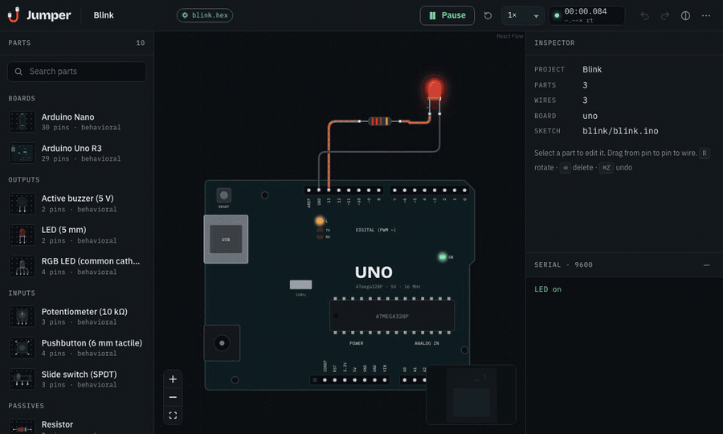

# Status: M0 Foundations

Last updated 2026-11-08. M0 is done: every item in the M0 scope works end to end, the 60 fps bar with 200 parts holds on a machine with a GPU, and every check below is green locally.

## What works

| Area | What you can do | Check it with |
| --- | --- | --- |
| Monorepo | pnpm 10 workspaces, TypeScript sources exported directly (no inter-package build), Node 24 | `pnpm i && pnpm typecheck` |
| Project format | `jumper.json` with a zod schema, readable errors (`wires[0].to.part: …`), stable git-friendly serialization, exported JSON Schema | `pnpm gen` writes `packages/project-format/jumper.schema.json` |
| Circuit solver | MNA DC solver in `@jumper/sim-core`: resistors, sources, piecewise-linear diodes, switches, floating-node detection (a wired input with nothing driving it gets a `floating-input` warning); re-solves only when something changes | `pnpm vitest run packages/sim-core` |
| Deterministic clock | Virtual time is the MCU cycle count; same project gives the same trace hash whatever the frame slicing | `packages/sim-backends/src/simulation.integration.test.ts`, `packages/parts/src/blink.integration.test.ts` |
| AVR backend | avr8js ATmega328P (Uno and Nano pin maps), GPIO, UART, ADC, timers | `pnpm vitest run packages/sim-backends` |
| Golden firmware | Blink built with arduino-cli 1.5.1 + `arduino:avr@1.8.8` in Docker; byte-identical on arm64 and amd64; committed as `examples/blink/firmware/blink.hex` | `scripts/build-firmware.sh` (see `examples/blink/firmware/BUILD.md`) |
| Parts | 10 parts (Uno, Nano, LED, RGB LED, resistor, pushbutton, slide switch, potentiometer, photoresistor, buzzer), each with `part.json`, `model.ts`, `visual.svg`, `fidelity.json`, `model.test.ts`; codegen registry with a validator | `pnpm gen`, `pnpm --filter @jumper/parts gen:check` |
| Canvas | Pan, zoom, pinch, dot grid, snap, minimap; place from the library (click or drag); wire pin to pin; select, delete, rotate, recolour; undo/redo (top bar and keyboard on desktop, the bottom dock on phones); inspector; light/dark theme; phone layout with a bottom sheet | `pnpm test:e2e` (`e2e/viewport.spec.ts`, `e2e/wire.spec.ts`, `e2e/app.spec.ts`) |
| Live simulation | Blink opens by default. Run lights the LED and the board's L LED from the simulated current, HIGH wires glow, the serial console prints `LED on` / `LED off` | `pnpm test:e2e` (`e2e/blink.spec.ts`) |
| Brand | Logo, wordmark, favicon, social card, `brand/tokens.css` (dark-first, light theme, OS preference) | `brand/README.md` |
| CI | `.github/workflows/ci.yml`: install, generated files up to date, typecheck, unit tests, Playwright desktop + phone, report upload | Not run on GitHub yet (no remote); every step passes locally |

## Checks (local, 2026-11-08)

| Command | Result |
| --- | --- |
| `pnpm gen` | 10 parts written, schema written; `gen:check` reports "registry up to date" |
| `pnpm typecheck` | 0 errors (TypeScript 7.0.2) |
| `pnpm test` | 21 files, **178 tests passed**, 0 skipped, 0 todo. By package: parts 126 (including the fidelity-vs-backend cross-check), sim-core 26, project-format 11, sim-backends 10, web 5 |
| `pnpm test:e2e` | **17 passed, 4 skipped** (the skips are device-specific tests on the other device): 8 on desktop (1440×900), 8 on phone (iPhone 13 viewport, Chromium), plus the 200-part benchmark, which runs last and alone in full Chromium with the GPU and gates the 60 fps bar (≥ 58 fps and p95 ≤ 17.5 ms, idle and running; CI without a GPU uses a 30 fps / 50 ms floor). Run three times in a row: green each time |

## Measured numbers

All measured on the dev Mac (Apple Silicon, 16 cores) while other work was running on it, so treat them as lower bounds.

| What | Number |
| --- | --- |
| Blink sim speed, Node 24, full `Simulation` with the real parts | **5.8× to 6.3× real time** (10 s of virtual time in 1.59 to 1.74 s, three runs) |
| Blink sim speed, browser main thread, speed set to 4× | holds **4.00× real time** |
| Blink sim speed, browser main thread, speed set to 8× (labelled `8× max`, best effort) | **4.9× real time** (capped by the 12 ms per-frame budget) |
| Blink at 1× in the browser | holds **1.00× real time** |
| Canvas with 200 parts (Uno + 66 resistor/LED pairs on D13 + 67 other parts, 198 wires), idle | **60 fps** (p95 frame 16.8 ms), three runs |
| Same canvas while Blink runs | **59.2 to 60.0 fps** (p50 16.7 ms, p95 16.7 to 16.8 ms, worst frame 16.8 to 50 ms), three runs. Before the fix: 55 to 57 fps, p95 33 ms |
| Simulation JS per frame at 1× with 200 parts | about **3 ms** (p95 3.6 ms); the rest of the frame is free |
| Determinism | identical trace hash for one 2.1 s run vs 131 frames of 16 ms; `timeMs` differs by less than 1 µs |
| Demo GIF | `docs/media/m0-blink.gif`, 1.0 MB, 5.7 s (still: `docs/media/m0-blink.png`) |

The benchmark is `apps/web/e2e/perf.spec.ts`; it writes `apps/web/test-results/perf.json`, including the GPU it ran on. What was costing frames was not the simulation (about 3 ms of JS per frame) but rendering: the clock re-rendered React every frame, and the flowing-dash animation on 132 HIGH wires made the browser re-rasterize every frame. The clock is now written straight to the DOM, and past 32 live wires the dashes hold still while the wires keep glowing. The old benchmark ran in the headless shell, which composites in software; that measured the CPU rasterizer (about 45 to 55 fps whatever the app did), not what a person with a GPU sees. The demo is re-recorded with `pnpm dev` and then `node apps/web/scripts/record-demo.mjs`.

## Known gaps (honest)

- **The simulation still runs on the main thread.** It costs about 3 ms per frame at 1×, so the 60 fps bar holds, but a heavy sketch or a much bigger circuit would compete with rendering. Moving it into a Web Worker is planned for M1.
- **Browser sim speed is reliable up to 4×.** The `8× max` setting is best effort and reaches about 5× real time (Node manages about 6×), because of the 12 ms per-frame budget on the main thread. The clock always shows the real factor.
- **On machines without a GPU the 200-part canvas renders slower.** In software compositing (for example the Playwright headless shell, or a CI runner) it measures 45 to 55 fps. That is why CI only enforces a 30 fps floor.
- **With more than 32 HIGH wires at once the dashes stop flowing**; the wires still glow. This keeps the frame rate at 60.
- **No SPI or TWI (I2C)** in the AVR backend. Sketches that use `Wire` or `SPI` will not work, and the board fidelity cards say so. This is M1 scope.
- **Floating inputs read LOW, not random.** The solver ties a node with no DC path to ground through 1 GΩ. A real pin would pick up noise. The board model raises a `floating-input` warning for any wired input with nothing driving it, and the fidelity cards list it, but the web app does not show part diagnostics yet.
- **PWM is one pin change per edge**, so `analogWrite` costs one circuit solve per edge. It is correct but slow at high duty-cycle rates.
- **All ground pins share one node**, even the grounds of two boards that are not wired together.
- **Firmware is not built from the browser.** You load the committed `.hex` or open your own; building happens with `scripts/build-firmware.sh` (Docker).
- **CI has not run on GitHub** because there is no remote yet. Every step of `ci.yml` was run locally.
- **`RESET` and `AREF` are not wired to the emulated CPU.** The ADC always uses AVCC = 5 V as its reference.
- **Contact addresses are placeholders**: `conduct@jumper.dev (TBD)` in `CODE_OF_CONDUCT.md` and `security@jumper.dev (TBD)` in `SECURITY.md`.
- **The Contributor Covenant text was written from memory.** Check it against the official 2.1 text before publishing.

## Next: M1, real Arduino projects

From `docs/brief.md`:

1. arduino-cli builds in a container, triggered from the project (not only from the script).
2. Serial console: input (send to the board), baud rate handling and timestamps. Output already works.
3. I2C/SPI buses in the AVR backend, with bus-level parts.
4. 25 parts.
5. A scenario test runner (`scenarios` in `jumper.json`).
6. A CLI `test` command (`jumper test`).
7. A GitHub Action example.

Also carried over from M0: run the simulation in a Web Worker (raises the speed ceiling above about 5×), show part diagnostics such as `floating-input` in the UI, and publish the CI run once a remote exists.
