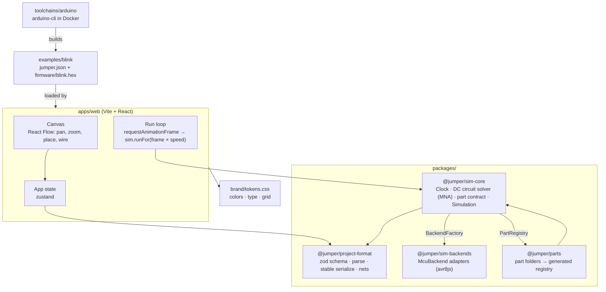
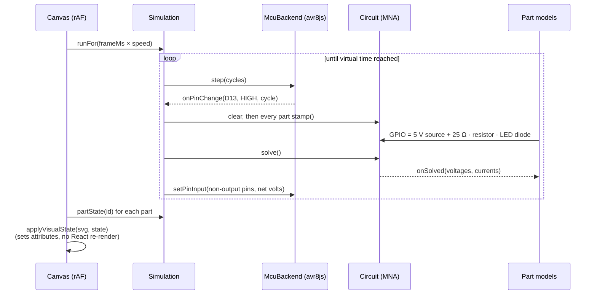

# Architecture

Jumper has three layers: a **canvas** where you build, a **simulation** that runs the real firmware against models of the parts, and (from M2) an **agent** that drives both through the same tools a person uses. M0 builds the first two on the smallest slice that proves the loop: Arduino Blink with a live LED.

Decisions behind this are in [decisions/0001-m0-foundations.md](decisions/0001-m0-foundations.md). The exact APIs are in [contracts.md](contracts.md).

## Packages

| Package | Owns | Depends on |
| --- | --- | --- |
| `@jumper/project-format` | The `jumper.json` schema, parser with readable errors, stable serializer, net builder, and JSON Schema export. | zod |
| `@jumper/sim-core` | The deterministic clock, the MNA DC solver, the part spec and model contract, the `McuBackend` interface, the MCU board helper, and the `Simulation` that ties them together. | project-format, zod |
| `@jumper/sim-backends` | Emulator adapters behind `McuBackend`. M0 has `avr8js` for the ATmega328P. | sim-core, avr8js |
| `@jumper/parts` | One folder per part (`part.json`, `model.ts`, `visual.svg`, `fidelity.json`, `model.test.ts`), plus a generated `registry.gen.ts` that inlines the JSON and SVG. | sim-core |
| `apps/web` | The canvas UI, the run loop, and the part visuals with live bindings. | all of the above |

Internal packages export TypeScript source, so there is no build step between packages. Vite and Vitest compile everything on the fly.

## Data flow while running

The important properties:

- **Deterministic.** Time is the MCU cycle count, never the wall clock. The UI only decides how much virtual time to ask for per frame. A test can run 10 virtual seconds in a few milliseconds, and the pin and serial trace hashes to the same value every time, whatever the chunk size.
- **Solve on change.** The circuit is re-solved only when something changes, such as a pin toggling, a prop being edited or a button being pressed. That is cheap for kit-sized circuits.
- **Cheap animation.** A part's SVG is inlined once. Each frame, `applyVisualState` writes only the bound attributes (`data-bind="opacity:brightness"`), so a blinking LED costs one `setAttribute`.

## Loading a project

1. `parseProject(jumper.json)` validates the structure.
2. `new Simulation({ project, registry, backendFactory, firmware })`:
   - builds the nets from the wires; every ground pin is merged into node `0`;
   - creates the MCU backend for `firmware.board` and loads the `.hex`;
   - instantiates each part's model through the registry (an unknown part type becomes a diagnostic, not a crash);
   - solves the circuit once.
3. The canvas renders parts from the registry's `spec.size`, `pins` and `svg`, and draws wires between the `part.json` pin coordinates.

## Where things will go

| Milestone | Adds |
| --- | --- |
| M1 | `services/runner` (containerized arduino-cli builds), serial input, I2C/SPI buses in sim-core, a scenario test runner, and the `jumper` CLI. |
| M2 | `packages/agent` and an MCP server that exposes canvas and sim actions as tools. |
| M3 | More backends behind the same `McuBackend` interface (QEMU-ESP32, rp2040js, Renode), the confidence report built from `fidelity.json`, and design-rule checks. |
| M4 | `packages/physics` (MuJoCo or Rapier) bound to motor and sensor models. |
| M5 | `services/device-farm`, which runs the same scenarios on real boards. |
