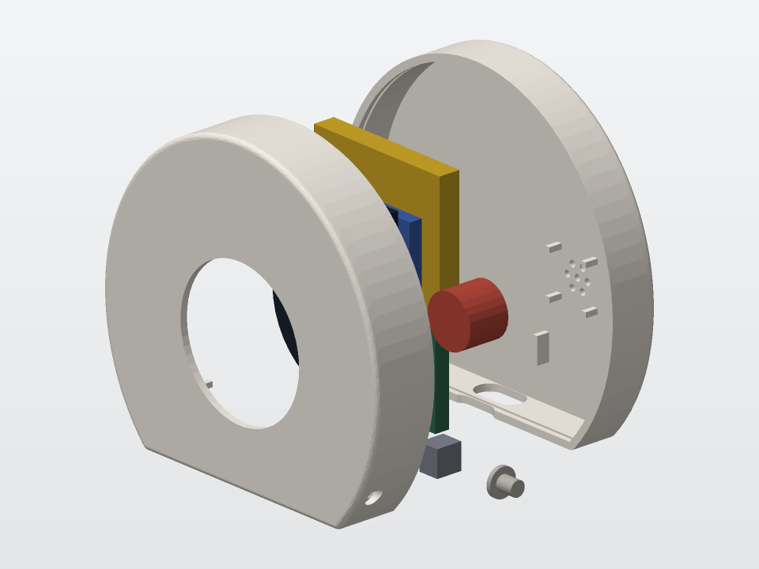
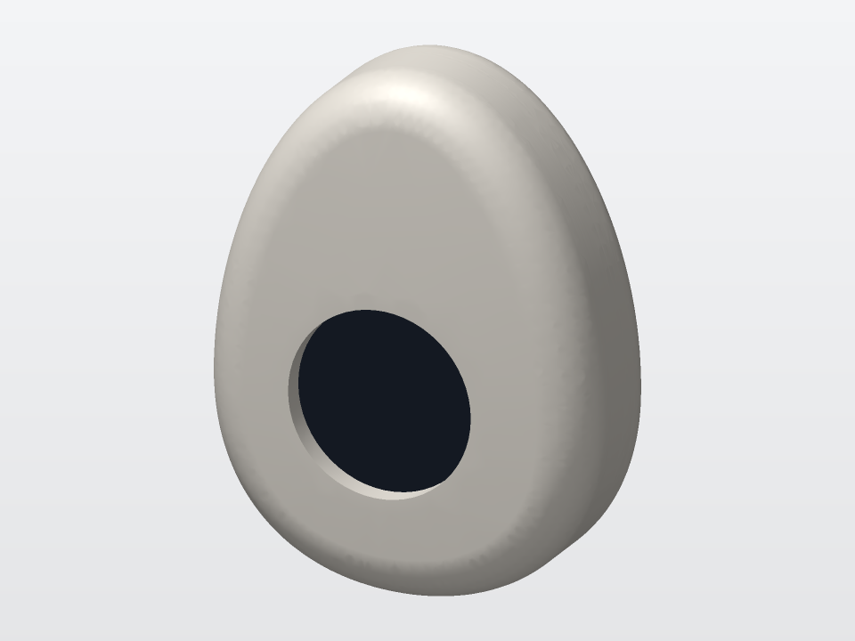
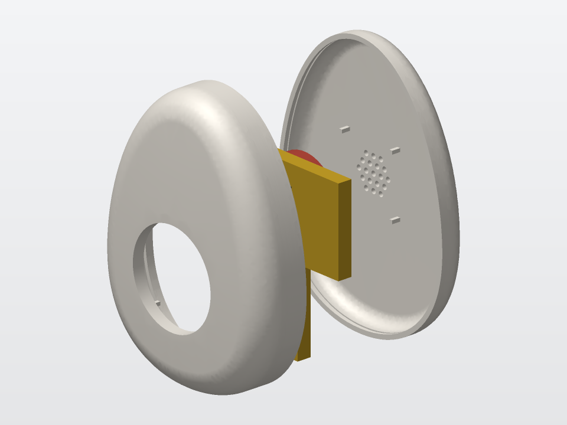

# Cases and the factory pack

Round 6 (decision [0004](decisions/0004-round6-real-device.md)): a Faber project can be finished
as a real object. `design_case` packs its parts into a two-part printable case and writes every file
a 3D printer or a factory needs; `export_manufacturing` adds the electronics, the firmware, the
assembly steps and the test plan into one pack a supplier can follow.

<p align="center"></p>

## Use it

From an agent (MCP) or the shell (same names):

```sh
faber design_case '{"shape": "pebble"}' -p examples/agent-built/claude-pocket-muse
faber design_case '{"shape": "puck", "save": false}' -p …      # compare a shape, faber.json untouched
faber update_case '{"params": {"closure": "screws", "color": "#2B3038"}, "placements": {"pet": {"face": "left"}}}' -p …
faber get_case -p …                                            # the report; regenerates stale files
faber export_manufacturing -p …                                # manufacturing/<name>-v<version>/ + .zip
```

In the web app: the **Case** button (box icon, top right; on phones in the ⋯ menu) opens the Case
view: the case in 3D with the parts inside, a **See-through** and an **Explode** slider, the shape
picker and settings, **Design case / Update case**, the fit checks, the size and the pocket verdict,
downloads (STL, 3MF, STEP, drawing, print notes) and **Factory pack (zip)**. It needs `faber serve`
(the CAD runs on the server; the browser only gets meshes).

## Any shape, any size (round 7)

The five shapes below are starting points, not the only choices. A case can be **any outline**:
`shape: "custom"` with an `outline` the agent or the person draws, at **any size** with `size_mm`.
There is no preset per object: an egg, a heart, a bean or a guitar pick is a custom outline.

```sh
# an egg 56 x 73 mm drawn as an SVG path (y DOWN, like any SVG): narrow top, wide bottom
faber check_fit '{"shape": "custom", "outline": "M 0 -40 C 17 -40 28 -16 28 5 C 28 23 16 33 0 33 C -16 33 -28 23 -28 5 C -28 -16 -17 -40 0 -40 Z"}' -p …
# the same kind of egg as points (y UP) through which a smooth closed curve runs, at a fixed size
faber design_case '{"shape": "custom", "outline": {"points": [[0,40],[14,33],[24,16],[28,-4],[24,-22],[13,-32],[0,-34],[-13,-32],[-24,-22],[-28,-4],[-24,16],[-14,33]], "smooth": true}, "size_mm": {"w": 64, "h": 84}, "params": {"dome_mm": 2}}' -p …
```

- **`outline`** is the front view in mm: an SVG path string (`M L H V C S Q T A Z`, absolute or
  relative; y points down as in any drawing program) or `{"points": [[x, y], ...], "smooth": true}`
  with y up (the device's top is +y; `smooth: false` = straight lines whose sharp corners are rounded
  so they print). It must be one closed shape that does not cross itself; errors say where and how
  to fix it. The outline becomes one periodic cubic B-spline: OpenCascade builds the shell from that
  curve and the packer tests points against the same curve (a signed distance field), so what is
  checked is what is printed. Its proportions are kept; its drawn size only matters as a ratio.
- **`size_mm`** `{w, h, d}` (any of them; the rest auto). With w / h the outline is scaled to exactly
  that size and the case is that size; with neither the outline grows uniformly to the smallest
  size that holds the parts (never under 15 mm, at most 250 mm). `d` (or `params.depth_mm`) fixes the
  thickness. A preset with `size_mm.w` / `h` becomes its own outline at that size (same pipeline).
- **3D finish, any shape** (`params`, each a number or `"auto"`): `edge_radius_front_mm`,
  `edge_radius_back_mm` (the rim round-overs; clamped where a side port needs a straight wall, with
  a warning), `dome_mm` / `dome_back_mm` (how far each face bulges as a sphere cap with a flat print
  pad; auto is about 1 mm on pebble and custom, flat on the rest), `depth_mm`.
- **Packing inside the real outline**: the parts are packed straight into the outline, inset by the
  wall, the wiring gap and the rim round-over at their depth, not into its bounding box, so the
  narrow end of an egg holds less than its wide end; the screen stays on the centre line but moves
  up or down to where the outline is wide. A custom outline keeps its silhouette: a port on a curve
  gets a spot face; only where a plug could not reach at all is a local flat (up to 8 mm deep) cut,
  and the report says so (a heart's point, a lobe); never on a fixed size, which stays exactly that size. Ports try other sides first (a heart's bottom is
  a point), and a layout where a plug would not reach loses to one where it does.
- **When the parts do not fit** a fixed size, nothing grows and nothing is saved: `design_case` /
  `update_case` return `fits: false`, `misses` (`{part, type, dimension: "outline" | "depth", short_mm,
  where, message}`, e.g. "eyes (gc9a01-round-tft) sticks out 3.1 mm at the bottom of the outline")
  and `suggestions`, each tried with the same layout (`fits`, `size_mm`) and given as the calls that
  make it (`change: [{tool, args}]`): a smaller part in the same role from the library (a 0.96" SSD1306
  instead of the GC9A01, a 20 mm speaker instead of a 28 mm one, a smaller board with the same chip),
  a smaller LiPo cell (the `capacity` prop picks the pouch: 150 mAh 402030, 250 mAh 502030, 500 mAh
  503035, 1000 mAh 523450), a board stood on its edge (`placements: {"xiao": {"on_edge": true}}`),
  less rounded rims, or "make it N mm bigger" with the size that holds everything.
- **`check_fit`** (or `design_case {"dry_run": true}`) answers all of that without CAD in about one
  to two seconds (with the layout proposals, below) (the suggestions are tried while about a second lasts; untried ones have no `fits`;
  `try_suggestions: true` tries them all; `design_case` with a size that misses tries them all).
  `check_fit` with no arguments tests the saved case; `preview: true` adds the front-view geometry.
- **In the Case view**: **Custom** opens the outline editor: start from an ellipse or a preset, drag
  the points, double-click (or **+ Point**) to add one, **− Point** to remove the selected one; Tab
  to a point, arrows move it 1 mm (Shift: 5 mm), Delete removes it. **W / H / D** in mm (blank =
  auto). The parts' footprints are drawn inside the outline at real size as you edit, red where one
  runs into the wall, with what misses and what would fit under it (**Use N × M mm** takes the size
  that holds everything). An outline an agent drew opens in the same editor.

<p align="center"> </p>

## How the parts are distributed (round 8)

Faber decides where every part goes by itself, for any outline at any size, and proposes the best
ways to do it:

```bash
faber propose_layout '{}' -p my-egg            # the saved case; or any design_case arguments
faber update_case '{"layout": "thinnest"}' -p my-egg
```

- **The model**: each part is a box (its size, keep-outs and the 10 % a cell may swell) that turns
  0 / 90 in plan, may stand on its edge (never the cell, the screen or a grille that must face the
  back), and keeps its constraints: the screen behind its window on the front, the speaker grille on
  its face, every USB port, button and switch reaching its wall (a port may take another side on a
  curved shape, each on its own), wiring room between parts (`gap_mm`), the wall and the rim
  round-over at the part's depth (a part against the front or back face keeps clear of the rounded
  rim; one in the middle of the depth less so), heavy parts low in an upright outline (an egg).
- **The search**: flat first, every part side by side in one layer inside the real outline; then
  the depths where two parts stack (the cell behind the screen), then three. At each depth a
  bottom-left fill (each part to the lowest free spot, next to the parts already there or against
  the wall; a part with a port against its wall) decodes an order, and a seeded walk over the order,
  the turns and which layer each part is in shrinks the outline as far as it holds everything.
  Round 7's front-to-back stacker is one more candidate. Deterministic: the same project gives the
  same proposals (the time box, 6 s, only stops a search that runs far longer than planned).
- **The proposals**: `thinnest` (least thickness), `smallest` (least volume), `balanced` (pocket
  first: thickness over 18 mm and a footprint over 110 x 70 mm weigh up). Each has `size_mm`,
  `volume_cm3`, `pocket`, `fill_ratio` (the parts' volume over the cavity's), `layers`
  (`[{index, z_mm, parts}]`), `placements` (`{part: {x_mm, y_mm, z_mm, rot, on_edge, layer, face}}`),
  `why` (plain words: "3 layers: the cell behind the screen", "12.8 mm thinner than stacking every
  part front to back"), `misses` (a fixed size it does not fit), `warnings` and `source`.
  `views: true` (and `POST /api/case/layouts`) adds a front view and a side view per proposal: the
  outline, the cavity and a labelled, coloured rectangle per part with its layer.
- **Choosing**: `enclosure.layout` (`design_case` / `update_case` `{"layout": ...}`) is `auto`
  (default, = `balanced`), `thinnest`, `smallest` or `balanced`. `check_fit` returns the proposals
  too (`proposals`, with `chosen`), and `report.json` records the one the case was built from
  (`layout: {goal, asked, fill_ratio, layers, why, source}`).
- **Pinning**: a part with `placements` `x_mm` / `y_mm` (its feature's centre on the front or back,
  or the part's centre when nothing of it shows), `layer` (0 = against the front, 1 = towards the
  back) or a `face` stays there and the optimizer arranges the rest around it. Each proposal's
  placement has `pin: {x_mm, y_mm, x_sign}`: the values that hold that part exactly where it is (a
  part on a side wall only slides along it, so it has one of them). To move a part by (dx, dy) mm
  as seen from the front, pin it at `{x_mm: pin.x_mm + x_sign * dx, y_mm: pin.y_mm + dy}`.
  `update_case` merges a placement field by field; a field set to `null` is removed (back to auto).
- **In the Case view** (round 8 view): the **Layout** tab shows the three proposals as cards, each
  drawn from the front and in cross-section from the side with the sizes in mm, how thick it is,
  the pocket verdict, how full the inside is and why. Picking one previews it in 3D (the parts as
  labelled boxes in the see-through shell); **Use** builds it; the card of the layout the case was
  built with (by the person or an agent) says "built". In the big front view a part can be dragged
  (or moved with the arrow keys) to keep it there: the rest is re-arranged within a second or two
  and the new size shows. A drop on a part that stays put is refused, and a spot the other parts
  cannot fit around sends it back, each with the reason. **Re-distribute** shows when the built
  case is older than the optimizer or Faber now finds another way.
- **Parts you may not need** (the same tab): the parts advice (`check_design`'s
  `boost-not-needed`, `smaller-speaker`, ...) in plain words with the room it would save. A swap or a
  removal has an Apply button, which runs the agent's own operations (`remove`, `place_part`,
  `connect`) as one undoable step: `GET /api/case/advice` (`{notes: [{id, code, title, why, saves,
  parts, apply?}]}`) and `POST /api/case/advice/apply {"id": "smaller-speaker:spk"}`.

## What each choice costs (round 8b)

An agent's own case choices can make a case much bigger than its parts need: a real Claude rebuilt
the talking egg on round-8 code at 74 x 96 x 44.4 mm with a 6 mm dome on both faces, the eyes and
the speaker pinned on the front and a fixed 74 x 96 mm size. So every `check_fit`,
`propose_layout`, `design_case` and `update_case` answer has `costs`:

- **Choices weighed**: each placement's `x_mm` / `y_mm` (together), `layer`, `face` and `on_edge`;
  `dome_mm` / `dome_back_mm` over 1.5 mm (relaxed to 1.5); numeric `edge_radius_front_mm` /
  `edge_radius_back_mm`; a fixed `size_mm` w / h, and d or `depth_mm`; `wall_mm` over 1.6; `gap_mm`
  over 1.5; `closure: "screws"`. A part with a speaker grille pinned on the front is weighed against
  its grille on the back (the front stays the screen's; a little quieter facing you).
- **How**: the quick proposal search (no CAD) runs again with that one choice relaxed, and once more
  with all of them relaxed (`relax_all`, run first), for the goal the enclosure asks for.
  Time-boxed (10 s by default, 5 s in `check_fit`): what is not reached is listed in `skipped`.
- **Answer**: `{base, costs: [{id, kind, part?, choice, with, without, adds_mm, adds_cm3,
  adds_length_mm, breaks_fit, message, say, change, label, tradeoff?}], relax_all, sizes_that_work?,
  free, skipped, ms}`, the costliest first. `message` is for agents ("A 6 mm dome on both faces adds
  9 mm of thickness (37.2 -> 28.2 mm thick with a 1.5 mm dome). Fix: update_case
  {"params":{"dome_mm":1.5}}"), `say` and `label` for people (no tool names), `change` the
  `update_case` arguments that relax it.
- **A fixed size**: at a fixed w / h the plan cannot grow, so the optimizer goes deeper until a
  layout fits, and `balanced` takes the thinnest layout that fits that outline (never a deep stack
  when a thinner one fits). When the parts do not fit, the answer names the choice that breaks the
  fit and `sizes_that_work` (the sizes the same outline works at, flat and stacked).
- **Dome**: a dome over 3 mm a face is a `dome` warning in the report with the thickness it adds
  over the default bulge (about 1 mm).
- **In the Case view**: the Layout tab's **What's making it bigger** lists the saved case's costly
  choices in plain words, each with an Apply button, plus "Let Faber decide all of these" and, for a
  fixed size that fails, the sizes that work (`POST /api/case/costs`).

## How it goes together (round 12)

Faber plans how the parts go inside at design time, for any case shape, and checks it. Every
`design_case` / `update_case` writes `case/assembly/plan.json` and a picture per step
(`case/assembly/step-NN.png`); `get_assembly_plan` (and `POST /api/case/assembly`, the Case view's
**Build** tab) returns it with what to buy and what to print:

```sh
faber get_assembly_plan -p my-egg        # {buy, print, consumables, tools, steps, mounts, checks, problems}
```

- **Mounting is designed, not assumed** (`packages/enclosure/src/mounts.ts`): each part gets a shell
  and what holds it, and the case adds what is missing where there is free room: locator ribs round
  a board (also off the wall), seat posts under a part that floats above its wall, standoff pins in
  mounting holes (round 6), hold-down posts from the other shell that stop a part lifting (they end
  0.3 mm clear of its keep-out, so they never press on components), a backstop behind a USB port,
  button or switch on a side wall (a plug or a finger pushes it inwards) and guides beside it, a
  cell's cradle with two strap slots or corner locators where the cradle does not fit, on a foam pad.
  Ribs are 1 to 1.2 mm, posts 2.4 to 3 mm, printed with the shell open side up (no supports); no
  feature touches another (two solids meeting on a face would leave the shell open there). What
  cannot be made is said with the room it needed, and the part is held with foam tape.
- **The order** (`packages/enclosure/src/assembly.ts`): the front shell comes straight down onto the
  back one, so a part in the front shell never sits behind one of the back shell it overlaps
  (`assembly-close`). In each shell a part another one covers goes in first; a switch whose lever
  pokes through a hole in one shell is held away from its wall and slid out to it, so it goes in
  before what would block its way (and its backstop comes with the other shell); plungers and light
  pipes go in before the parts behind them. A cell nothing goes over is placed last.
- **Wires**: each is soldered as soon as both of its parts are in; a pad that a later part will
  cover gets its lead soldered on the bench first (two covered ends: two leads and a splice). Wires
  between the shells are soldered with the case open like a book on the side nearest their ends
  (`opens_on`), and are cut long enough for it (`open_mm`, used in WIRE-CUTS.csv). Small passives
  that ride in the wiring are soldered in line on the bench.
- **The steps**: check the print (test-fit the empty shells), heat-set inserts, flash the bare
  board, cut and tin the wires, the shells part by part (each step says how the part is held), the
  wires between the shells, a test on USB, then the battery (foam pad, Kapton, one lead at a time),
  a test on the battery, close, a closed test. Each step: `{n, title, say, shell, parts, action,
  fasteners, wires, tools, cautions, view: {explode, highlight, camera}, image}`.
- **Checks** (in `report.checks`, in `check_design` once the case is built, and in the Build tab),
  each with what failed, why, the fix and `facts` (sizes):

| Check | Fires when |
| --- | --- |
| `assembly-close` | a front-shell part sits behind a back-shell part it overlaps: the case cannot close |
| `assembly-insert` | a part cannot go in after another (each must go first), or a lever cannot slide in (room behind it, a rib in its path) |
| `assembly-solder` | a joint can only be made with leads and a splice (both pads end up covered) |
| `assembly-wires` | the thickest wire is wider than the wiring room (`gap_mm`), the wires (with slack, bundled) fill more than 60 % of the free room (warning past 30 %), or the bundle between the shells has little room at the seam |
| `assembly-access` | a USB port (flashing, charging) has no opening when closed; the board's BOOT button inside (warning: flash before closing) |
| `assembly-battery` | a hard edge (a part, a post, a screw boss) within the cell's swell + 0.5 mm, or no cradle / corner locators |
| `assembly-screws` | a screw has no straight path for the driver (under the belt clip or the tab) |
| `assembly-held` | a part is held by foam tape where a printed clip would be better (with the room it needed) |

- **Consumables and tools** come with the plan (wire by gauge with 20 % spare, heat-shrink, solder,
  Kapton and a foam pad for a cell, foam tape where used, screws and inserts, glue for a belt clip),
  and the factory pack's BOM adds the Kapton and foam pad. `assembly/ASSEMBLY.md` in the pack is the
  plan: what to print, consumables, tools, how each part is held, every step with its picture.
- **Honest limits**: wire routes are not drawn as real paths (the pictures show straight runs; the
  room is a volume budget); a pad's position comes from the part's drawing, on its top face, and
  pads are assumed reachable from either side of the board (through-hole or castellated); the snap
  and hold-down fit, foam and Kapton thickness and the soldering itself are not checked on a real
  print; a stale plan after a rewire is made again without new pictures until the case is rebuilt.

## Shapes and settings

| Shape | What it is |
| --- | --- |
| `rounded-box` | Rounded rectangle (corner radius `corner_radius_mm`), small edge round. The most compact. |
| `pill` | Capsule: semicircular ends on the long axis, front and back edges rounded in 3D (up to ~0.44 of the depth). |
| `pebble` | Oval plan, sized around the parts, centred on the screen in x; front and back edges rounded in 3D with one large fillet each (up to ~0.44 of the depth), both faces domed about 1 mm with a flat land round the window and a flat pad on the back (what each shell prints on). |
| `puck` | Round, centred on the screen, edges rounded in 3D (~0.34 of the depth). |
| `keychain` | Rounded box (7 mm plan corners) with 3D-rounded edges, a tab and a 5 mm lanyard hole. |
| `custom` | Round 7: any `outline` you draw (SVG path or smoothed points), at any `size_mm` or auto, rounded and domed like a pebble (above). |

`params` (all optional): `wall_mm` (≥ 1.2, default 1.6), `corner_radius_mm` (4), `color`
(renders + 3MF), `lanyard_hole` (default on for keychain; a small tab on other shapes), `belt_clip`
(a separate PETG clip glued to the back), `closure` (`snap` lip with a bead and groove, or `screws`:
M2 into brass heat-set inserts in the front shell's bosses, counterbored from the back),
`tolerance_mm` (0.2 FDM, 0.1 resin, 0.05 injection), `process` (`fdm` / `resin` / `injection`:
notes, materials and tolerances), `gap_mm` (1.5: wiring room around each part).

`front`: the part whose screen faces out (default: the first display). `placements`: per part,
`{"face": "front" | "back" | "left" | "right" | "top" | "bottom" | "inside", "x_mm", "y_mm",
"rotation", "layer", "on_edge"}`, faces as seen holding the device with the screen towards you; parts left out
are auto-packed. `exclude`: parts not in the case (an external sensor on a cable).

## How the layout works

1. **Mechanical data** from each part's `part.json` (`mechanical`, [part-spec](part-spec.md#mechanical-and-sourcing-round-6)):
   footprint, keep-outs, mounting holes, and features (screen active area, button cap, USB port,
   LEDs, sensor windows, grilles, levers).
2. **Orientation**: the front part's screen faces +z. A part with an exposed feature turns so the
   feature faces its case face: USB to the bottom (a box or key fob: all on its bottom, with a flat
   wall; a pebble / pill / puck: the charging port at the bottom and the next on its own side, so no
   wall is cut flat; a spot face thins the wall round a port the curve holds back), buttons to
   the right / left / top, a slide switch's lever and sensor windows to the top, a buzzer's grille
   to the back. Everything else lies flat.
3. **Packing**: a front stack from the screen backwards and a back stack (the LiPo in its cradle,
   back grilles) from the back wall, as shallow as both allow, with `gap_mm` around each part. Side
   parts (ports, buttons, levers) slide to mid-depth so the edges can be rounded. Four part orders
   x 11 x 11 plan rectangles (and, on curved shapes, which port gets which side) are packed; the ~30
   most promising are finished into real layouts and the one with the smallest outer volume wins,
   weighed up when thicker than 18 mm (more past 22), when its edge radius falls short of the shape,
   or when it needs a flat. `report.volume_cm3` is the volume inside the outer surface.
4. **Plan**: the cavity outline for the shape is sized around the parts, allowing for the rounded
   front and back edges (the inner round is concentric with the outer one, so the wall is uniform).
   The outer outline is a true 2D offset of the cavity by `wall_mm`.
5. **Details**: window over the active area (+0.3 mm into the bezel), button plungers (flange
   inside, 1 mm proud, a hole with clearance), USB openings sized for the plug's overmold, light
   pipes for exposed SMD LEDs, sound holes, ribs that locate the screen module, standoffs + pins
   where a module has mounting holes and a free path to a wall, the cell cradle (+10 % swell), the
   snap lip or the screw bosses, the tab.

Case frame (STEP files, the web meshes, the report): mm, origin at the centre of the outer box, +x
right, +y up, +z out of the front. Every **STL is in print orientation**: the face PRINT.md names
lies flat on z = 0, centred on x = y = 0 (front shell face down, back shell open side up, caps and
light pipes on their flange, the belt clip on its L profile). `case.3mf` is one **build plate**:
every body in that pose, side by side 6 mm apart (item transforms). `step/assembly.step` stays
assembled.

## Checks (in every report)

| Check | Meaning |
| --- | --- |
| `fits` | every part is inside with the wiring room; small passives ride in the wiring |
| `screen-window` | window sized to the active area, not cutting past the bezel, and (round 8b) looked through: lines of sight straight in through the window must land on the display's active area, so a window off the screen, another part in front of it or nothing behind it fail, naming what is seen |
| `buttons-reachable` | each plunger goes through its hole, stands proud for the switch's travel |
| `connector-access` | the plug reaches: receptacle ≤ 2.5 mm inside the outer surface, opening on a flat |
| `camera-view` | round 14: each camera lens has its hole, with its size and position, wide enough for the lens' field of view at its depth behind the wall (warning when the wall shows at the photo's edges) |
| `min-wall` | wall measured between the outer and inner surfaces in OpenCascade (and at the snap groove), ≥ 1.2 mm |
| `printable` | prints on its outer face without supports (a socket's shell on its floor plate, round 17); overhang area of the rounded edge near the bed |
| `edge-radius` | round 17: the front / back rims got the radius planned, measured on what was built (`facts`: front_mm, back_mm, how: fillet / lofted / chamfer / sharp); a warning says why it is smaller and what to change |
| `watertight` | every STL is a closed 2-manifold with volume > 0 (re-checked from the file bytes in tests) |
| `no-intersection` | no part body overlaps a shell (OpenCascade common volume < 0.001 mm³) |
| `size-match` | the printed bodies are within 0.1 mm of the planned size |
| `pocket` | thickness first: `fits` (comfortable) ≤ 18 mm thick within 110 × 70 mm, `tight` ≤ 22 mm within 130 × 80, else `no` (bulky); the message names the reason and the volume |

What the case **cannot** check: snap strength and fit on your printer (print the two shells and test
before the rest), clone modules that differ by ~1 mm from the typical sizes, drop / water / heat,
and the actual route of each wire (`gap_mm` is a budget).

## Files

```
case/                    (outputs: regenerated from faber.json + the parts' data, never undone)
  stl/front.stl, back.stl, cap-<part>.stl, light-pipe-<part>.stl, belt-clip.stl
  case.3mf               build plate: every printable body in print orientation, named and coloured
  step/assembly.step     shells + plungers + the parts as named solids (AP214), front.step, back.step
  renders/front.png, back.png, exploded.png, inside.png
  drawing/drawing.svg    A3: front / side / bottom views, overall size, openings table, tolerances,
  drawing/drawing.pdf    material / finish, print settings (PDF when Playwright's Chromium is installed)
  PRINT.md               per body: face on the bed, supports, settings; resin and injection notes
  report.json, manifest.json (hash of the inputs: a stale case is regenerated by get_case / the view)
  variants/<shape>/…     design_case {save: false}
manufacturing/<name>-v<version>/ (+ .zip)
  README.md, README.zh-CN.md, NOTES.md, BOM.csv, BOM.md
  electronics/WIRING.md, netlist.csv, faber.net (KiCad legacy netlist), WIRE-CUTS.csv
  firmware/firmware.hex, firmware.uf2 (RP2040), FLASHING.md, source/
  enclosure/ (the case files), assembly/ASSEMBLY.md, test/TEST-PLAN.md, TEST-ON-HARDWARE.md
  build-kit/             round 12: the person-facing build kit (kit.html, KIT.md, SHOPPING.csv, PRINT-LIST.md)
  manifest.json          sha256 of every file
build-kit/<name>-kit/ (+ .zip)   get_build_kit / Build it: what to buy, print, assemble, flash (docs/build-kit.md)
```

The web view's meshes are cached in `.faber/case-mesh.json`.

## Engine and licences

CAD: [replicad](https://github.com/sgenoud/replicad) 1.1.0 (MIT) on the OpenCascade WebAssembly
build `replicad-opencascadejs` 1.1.0 (LGPL-2.1, loaded unmodified at run time, see NOTICE), in
Node only (`packages/enclosure`, loaded lazily). STL / 3MF are written by Faber (3MF zipped with
fflate, MIT), renders by Faber's own rasteriser (no browser), the drawing as SVG (PDF printed by
Playwright's Chromium when present). This OpenCascade build has no IGES writer: the pack ships
STEP AP214, which factories accept (convert to IGES in FreeCAD if one insists).

## Honest limits (round 8, distribution)

- The optimizer is a search (a greedy fill and a seeded local walk), not a proven optimum; on the
  talking egg it lands within a few percent of what more steps find. About 1.5 to 2 s for 10 to 15
  parts (presets try two aspects), check_fit included; design_case reuses the answer.
- Its outline test is radial (fast); the finished layout is then sized with the exact outline, so
  a proposal's size can differ from the search's estimate by a few tenths of a millimetre.
- Thickness includes `dome_mm` on both faces: the egg drawn with `dome_mm: 3` is 6 mm thicker than
  the same parts with flat faces.
- Buttons, switches and knobs keep the side the rules give them (a port may move to another side).
- Costs (round 8b) relax one choice at a time (and all at once): two choices that only cost
  together show up only in `relax_all`. They come from the light search, so "with" can differ from
  the built case by a few tenths of a millimetre. A pin at a fixed outline often costs nothing (the
  outline, not the pin, sets the size).
- The exploded render and the web view's explode move the parts the front shell holds (the screen,
  a front grille's speaker) with the front shell (round 8b); before, the window showed whatever was
  behind it by parallax.

## Honest limits (round 7, custom outlines)

- Round 7's packer (still one of the round-8 candidates) is a search, not an optimum; `check_fit`
  and `design_case` now share the round-8 proposals, so they agree. Suggestions are each one change, tried alone.
- A narrow tip or a deep notch is rounded less than the rest (OpenCascade cannot roll a large rim
  round a tight curve; the report says the radius it made). Outline necks narrower than two walls
  plus 4 mm are reported, not fixed.
- LiPo cell sizes by capacity are typical pouch sizes; the real cell can differ by about 1 mm.
- The editor edits points through which a smooth curve runs; an SVG path an agent drew opens as 14
  points along its silhouette (saving it from the editor replaces the path with those points).

## Honest limits (round 6)

- Edges round as far as the side openings allow: every port, plunger and lever needs its hole on
  the straight band of the side wall, so the front and back radii differ when a port sits off
  mid-depth (the Muse pebble: 6 mm front, 2.7 mm back). Packing is a search, not an optimum.
- Parts without mounting holes are located by ribs (screen) or held with foam tape; standoffs are
  only made where a column to a wall is free.
- Wire cuts (`wireCuts` in `packages/session/src/assembly.ts`, shared with `export`) take the pin
  distance in the case layout × 1.3 for routing plus 10 mm strip and 15 mm slack, rounded up to 5 mm;
  without a case they are estimates from the part sizes (the CSV says which). Not routed paths.
- No PCB layout: the pack is for a hand-wired / perfboard build; `faber.net` is where a PCB starts.
- Sourcing has MPNs and plain descriptions; LCSC / JLC numbers are left empty until checked.

## Things the case holds (round 15)

A case can hold something that is not electronics: a tin of pouches or mints, a lip balm, a lighter,
a card deck. Declare it on the case (never as a fake part):

```sh
faber design_case '{"shape": "rounded-box", "held": [{"id": "tin", "name": "round tin", "shape": "cylinder", "size_mm": {"d": 66, "h": 21}, "clearance_mm": 0.5, "insert": "slide", "from": "right", "source": "measured with calipers", "sensor": {"part": "lid"}}]}' -p my-holder
```

- **shape**: `cylinder` (`size_mm` `d` diameter, `h` height; `orientation` `flat` = round face to the
  front, default, or `upright`), `box` (`w`, `h`, `d`), `custom` (its bounding box).
- **insert**: `slide` (through a slot in a side: `from` left / right / top / bottom), `pocket` (an
  opening in the back, front or top), `snap` (a pocket whose rim overlaps the object by `lip_mm`,
  default 0.6, so it clicks in). `removable: false` = it goes in during assembly and stays (no opening).
- The packer gives it a room (its size + `clearance_mm` all round) against the side it goes in
  through and keeps every part out; the shell gets the slot or the pocket (cut through curved walls
  and domes); **sleeve walls** (1.2 mm) wall it off from the electronics where there is room, and the
  report says where there is not. Ribs and posts of other parts never enter its room.
- Checks: `held-object` (the room, the opening, the thinnest wall round it, a pocket rim the rim's
  round-over would eat, with the fix) and `held-sensor` (a reed / Hall switch must sit within
  `sensor.max_mm`, default 8 mm, of the object).
- `report.held[]` and the build kit's **What it holds** give the object, its room, the opening and how
  to check the fit: measure your own with calipers (the lid's rim is often the widest part), raise
  or lower `clearance_mm`, and print a 2 mm test ring of the opening first.
- The assembly plan does not assemble it: a removable object goes in after the case is closed (the
  last step), a captive one before closing.

Proof: `packages/enclosure/test/held.test.ts` (layout), `held-cad.test.ts` (real CAD: a slide-in tin in
a rounded box, a back pocket in a pebble with a flat back: closed solids, nothing in the room),
`packages/session/test/round15-held.test.ts` (design_case, the kit).

### Depth from the outer face, sockets, magnets on the object, outlines that follow (round 17)

- **Depth counts from the OUTER face** of the wall the object goes in through (round 15 counted it
  from the inside of the wall, so the floor sat a wall thickness deeper than declared: 15.4 mm
  instead of 13.6). `report.held[].depth_mm` is the floor's depth below the outer face, measured on the
  layout, and `proud_mm` how far the object stands out of it (negative: it sits below the face); the
  `held-object` message says it in words. `held-depth-cad.test.ts` measures the floor on the mesh.
- **A socket the case rides on** (`engage_mm`): only that much of the object goes in, from the front or
  back face; the rest stays outside. A puck on a can's lid, a dock a bottle stands in, a cap on a
  tube. The case no longer has to be as thick as the object. `fit`: `slip` (default; clearance 0.3 for
  a socket), `press` (0.1: print a test ring), `snap` (a `lip_mm` rim at the mouth that clicks over
  the edge). Errors say what is wrong, why and the fix: deeper than the object, shallower than the
  wall + 0.6 mm, a socket in a side, a captive socket, a magnet with no sensor.
- **A magnet on the object** (`magnet`: `beyond_mm` from the case's outer face along the object,
  positive = outside; `angle_deg` round it, default towards the sensor; `radial_mm`, `d_mm`, `t_mm`):
  `held-sensor` reports the switch-to-magnet gap mounted and with the case lifted `sensor.lift_mm`
  (default 10) against `sensor.max_mm`, the lift at which the switch lets go, and the test steps that
  drive the simulated switch (`{"set": "reed.magnet_mm", "value": <gap>}`). It warns, with the fix,
  when the switch never closes or never lets go.
- **The outline follows the object** (`enclosure.follow`: `{"held": "can", "margin_mm": 0}`): the
  object's front-view footprint + clearance + margin + the wall each side (a can lying flat: a circle;
  a box: its w x h), concentric with it, drawn exactly in CAD. It sets `size_mm` w / h. The parts are
  packed in layers in front of / behind the object's room (the room is a layer of its own). With a
  socket, the seam goes on the socket's floor plate, a collar fills the cavity round the socket so its
  wall hugs the object, the rim round the mouth is kept within the wall, and the shell with the socket
  prints standing on the plate (no bridge over the socket).

```sh
faber design_case '{"shape": "puck", "params": {"edge_radius_front_mm": 2.5, "edge_radius_back_mm": 1, "dome_mm": 0, "dome_back_mm": 0}, "follow": {"held": "can", "margin_mm": 2.5}, "placements": {"reed": {"x_mm": 0, "y_mm": -33.5, "layer": 1}}, "held": [{"id": "can", "name": "pouch can (lid on)", "shape": "cylinder", "size_mm": {"d": 70, "h": 20}, "from": "back", "engage_mm": 6, "fit": "slip", "clearance_mm": 0.3, "magnet": {"beyond_mm": 2.5, "d_mm": 6, "t_mm": 2}, "sensor": {"part": "reed", "max_mm": 10, "lift_mm": 8}}]}' -p lid-topper
```

The fixture `packages/enclosure/test/fixtures/lid-topper.json` (XIAO ESP32-C3, 1.54" e-paper, DS3231
module, 500 mAh cell, reed switch) comes out 79 x 79 x 28.5 mm: a 70.6 mm socket 6.0 mm deep, the can
standing 14 mm proud (42.5 mm with the can), the reed 9.4 mm from the magnet mounted and 17.3 mm with
the case lifted 8 mm; both STLs closed (`held-socket-cad.test.ts` measures them). The 2.5 mm margin is
what the XIAO's USB port needs to reach a round wall; the thickness is the DS3231 module (12.5 mm with
its coin cell): a smaller clock module or the board's own RTC makes it thinner.

### Rounded edges (round 17)

Round 15's 2 mm rim on a fixed-size rounded box came out sharp: OpenCascade's fillet failed and only a
note said so. A preset shape at a fixed size (and a case that follows a held object) is now drawn
exactly in CAD (a circle, a rounded rectangle), which fillets reliably and builds in seconds instead of
minutes; a flat-faced case is built with sharp rims and rounded at the end; a fillet that fails falls
back to a lofted round-over through exact offsets of the outline, then a two-facet chamfer. A drawn
(B-spline) outline keeps a square-cornered cavity (OpenCascade cannot fuse sleeve walls into a rounded
one there), so its rim is capped where the wall at the rim would drop under 1.25 mm. The
`edge-radius` check reports what each rim got. `edges-cad.test.ts` measures the radius on the mesh.
