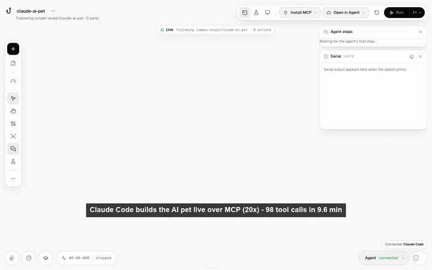

# AI pet on a colour screen, built live by Claude Code

Claude Code built this from a one-line goal, using only Jumper's tools over **HTTP MCP**
(`jumper serve`). The canvas was open in a browser and recorded the whole time. This folder is the
agent's final project, unedited: wiring, firmware, five scenario tests, its own screenshots and its
export. Two pictures from the recording were added afterwards (`device-live.png`, `tests-panel.png`).

<p align="center"></p>

Video (90 s, 1440x900, H.264): [`docs/media/live-claude-ai-pet.mp4`](../../../docs/media/live-claude-ai-pet.mp4).
It has four parts:
1. **The build (20x):** the live canvas while Claude works, 9.6 min of real time.
2. **The finished project in the browser (3x).**
3. **The Device view (2.5x):** TALK, FEED and PLAY are pressed on the 3D handheld, and a real Claude model answers.
4. **The Tests panel (5x):** the filmstrips, then one frame opened in 3D.

## The prompt (exact)

> Build me a tamagotchi with AI inside: a little creature on a color screen that I can talk to. It
> has three buttons (talk, feed, play) and a buzzer. When I press talk it asks its AI brain
> something and shows the answer in a speech bubble, its face changes with its mood, it gets hungry
> and sad over time and beeps for attention, and if the WiFi drops it shows it is offline and
> retries. Prove it with scenario tests, then show it running in the device view. Use the jumper
> tools; the owner is watching the canvas live, so explain each step in its why.

## The agent and how it ran

- **Agent:** Claude Code 2.1.319 (`claude-opus-5-5`, the default model), headless, 2026-11-09.
- **Server:** `jumper serve --project <empty folder> --port 7790`, and in Chromium at 1440x900 the canvas following it (`http://localhost:7790/`).
- **Command,** run from the empty folder:

  ```
  claude -p "<prompt>" --mcp-config '{"mcpServers":{"jumper":{"type":"http","url":"http://localhost:7790/mcp"}}}' --strict-mcp-config --allowedTools mcp__jumper --output-format stream-json --verbose --max-turns 250
  ```

  The mcp-config was passed as a file. Built-in tools were still listed, but only `mcp__jumper__*` was allowed.

| What | Number |
| --- | --- |
| Wall time | 576 s (9.6 min) |
| Cost | $2.69 |
| Turns | 99 |
| Tool calls | 98 in total. 92 were Jumper tools; the other 6 were 3 `ToolSearch`, 1 read of the `jumper://docs/agents` resource, 1 `Read` and 1 `Edit`. |
| Failed calls | 4. One was a built-in `Edit` on `main.ino`, refused by the permission setup; the agent switched to `write_file`. The other three were `write_scenario` calls using `expect_display` on the TFT, which Jumper rejected as "has no screen" (a Jumper bug, fixed below). |
| Firmware | 2 versions, 456 and 457 lines. No compile errors. Flash 21930 / 32256 B, RAM 788 / 2048 B. |
| Test runs | 3/5, 4/5, 4/5, then 5/5. The failures were the agent's own timing assumptions. |
| Live AI | `set_ai_mode live` and `run_live` (13 s at real time): claude-haiku-5-5 answered "Hi you! Food is pretty good, I feel bouncy!" in 2.9 s. |

Tool calls: 26 `connect`, 12 `write_scenario`, 10 `place_part`, 7 `run`, 5 `get_part`, 4 `interact`,
4 `run_tests`, 3 `search_parts`, 3 `check_design`, 3 `screenshot` (one of them `view: device`),
2 `write_file`, 2 `inject_fault` (`wifi_drop`, then `clear`), 2 `set_ai_mode`, 2 `get_project`, and one
each of `new_project`, `set_libraries`, `remove`, `read_network_log`, `run_live`, `fidelity_report`
and `export`.

## What it built

- **Parts:** an Uno; a 2.8" ILI9341 320x240 TFT on hardware SPI (CS 10, DC 9, RST 8); an ESP-01 on
  SoftwareSerial (RX D2, TX D3) powered from 3V3; TALK, FEED and PLAY buttons on D4, D5 and D6 to
  GND (`INPUT_PULLUP`); an active buzzer on D7.
- **Level shifting:** a 1k/2k divider on the ESP's RX line. A 1k series resistor on its TX line was
  added after `check_design` flagged 5 V reaching the ESP's TX pin through D2's pull-up.
- **Firmware** (`firmware/main.ino`, Adafruit ILI9341 + GFX):
  - **AI brain:** asks `GET http://ai.jumper/v1/pet?a=talk&f=…&j=…&e=…&n=Pip` over AT commands and
    draws the `mood|text` reply word-wrapped in a speech bubble.
  - **Faces:** five, one per mood: happy, ok, hungry, sad (with a tear) and sleepy.
  - **Status bar:** FOOD and JOY bars and a WiFi / OFFLINE badge.
  - **Over time:** food and joy fall every 2 s, and it double-beeps every 8 s while hungry or sad.
  - **Wi-Fi drop:** shows OFFLINE and "WiFi lost! Retrying...", rejoins every 5 s, and says "back
    online" when it reconnects.
- **Tests (5):**
  - `boots-online-happy`
  - `talk-asks-ai-and-shows-bubble`
  - `gets-hungry-beeps-then-fed`
  - `gets-sad-without-play`
  - `wifi-drop-offline-and-retry`

  They check serial lines, `expect_serial_value` for food and joy, the buzzer's `sounding` state,
  `wifi1.online`, and how many bright pixels the TFT shows.

## What was verified (by a person, not the agent)

All four checks below ran on a copy of the folder.

| Check | Result |
| --- | --- |
| `jumper check` | 0 errors, 0 warnings |
| `jumper build --force` | OK. Byte-identical to the agent's `main.hex`. Libraries: Adafruit ILI9341 1.7.0, GFX 1.13.0, BusIO 1.17.4 |
| `jumper test` | 5 passed, 0 failed |
| `jumper fidelity` | 3 parts simulated exactly, 7 by behaviour. Logic is exact; timing, analog, power and radio are approximate. 20 items to check on real hardware |

In the browser (recorded), with the server's **Live** AI using the logged-in `claude` CLI and claude-haiku-5-5:
- I pressed TALK, FEED and PLAY on the 3D handheld.
- The real replies showed in the bubble:
  - "Hi! I'm so hungry, and my joy is zero."
  - "Tummy rumbles! Got any snacks for me?"
  - "Hi hi! I'm full of beans, let's play!"
- The face went from hungry (orange) to ok (green) to happy (yellow with cheeks), and the bars moved.

The Tests panel showed 5/5 with a filmstrip per scenario, including the OFFLINE badge and the
retries.

**Not verified:**
- The buzzer's sound (the simulator has no audio; tests check its `sounding` state).
- The Wi-Fi drop in the browser: fault steps don't replay there yet. It is shown in the agent's
  `shots/offline.png` and the filmstrip.
- Mood faces are checked through the `face=` lines the sketch prints, not through pixels, because
  `expect_display` refused the TFT during the run.

## Friction (from the transcript) and what happened to it

1. **`expect_display` rejected the colour TFT.** The tool said: "tft1 is a ili9341-tft, which has no
   screen. Fix: point expect_display at a display part (ssd1306-oled-i2c, lcd1602-i2c)".
   - Effect: 3 failed calls, and the agent fell back to whole-screen `tft1.bright` counts. As it
     said: "the test tool can't check a region of the colour screen".
   - Fixed: `read_display` and `expect_display` now read colour panels (a pixel counts as lit when it
     isn't black), including regions and golden frames. Test in `packages/session/test/ai-pet-session.test.ts`.
2. **The built pet could not run in the browser that followed the agent.**
   - Effect: the canvas TFT stayed black, Run did nothing, and the Device view clock stayed at
     00:00.000. The only explanation was a toast hidden behind the Device view.
   - Fixed: `GET /api/project` on `jumper serve`, and `http://localhost:<port>/?local` opens the
     agent's project with its built hex, so it runs in the browser (screen, buttons, Device view,
     Network panel). The follow-mode Run toast now names that URL. Test in `apps/cli/test/serve.test.ts`.
3. **The Tests panel's empty state pointed to a dev-only script** (`node --import tsx
   packages/session/src/visual-report.ts …`), and the panel has no Run button.
   - Fixed: the hint now says `pnpm jumper test --visual -p <project dir>`.
   - Still open: a report from the agent's `run_tests` is held only in the server's memory and is
     lost when the server restarts.
4. **Live AI answered "happy|..." once,** a reply with no words, which was then cached for 15 s.
   - The cause wasn't confirmed.
   - The reply cleaner now uses the next line when the model puts its words after a line break, with
     a test in `services/ai-gateway/test/gateway.test.ts`.
5. **Not Jumper:** the agent tried the built-in `Edit` once (refused by `--allowedTools`), then used
   `write_file`. In its words: "Direct file edits aren't permitted here, which is fine — going
   through Jumper's `write_file` also puts the change on the canvas with its reason."
6. **Still open:**
   - **Agent pill:** it read "connected" before any agent had connected, and still read "building ·
     27 steps" after the agent finished.
   - **Frame overlay:** a test frame opened in 3D draws over the app's title and toolbar.
   - **Agent screenshot labels:** in the canvas screenshot the agent gets back, wires cross the part
     labels (for example "btnTalk").
   - **Frozen buttons:** each Wi-Fi retry blocks the buttons for up to 4 s, a limit of the agent's
     firmware that it flagged itself.

## Replay

`pnpm jumper replay examples/agent-built/claude-ai-pet/agent-actions.jsonl` (the agent's 92 calls).
To run it yourself: `pnpm start --project examples/agent-built/claude-ai-pet`. Then open
`http://localhost:7780/?local`, press Run, then the Device view button.
- **Talk to it:** press 1, 2 and 3 (TALK, FEED, PLAY).
- **Real AI:** start `node services/ai-gateway/bin/ai-gateway.mjs` and flip the Network panel to Live.
