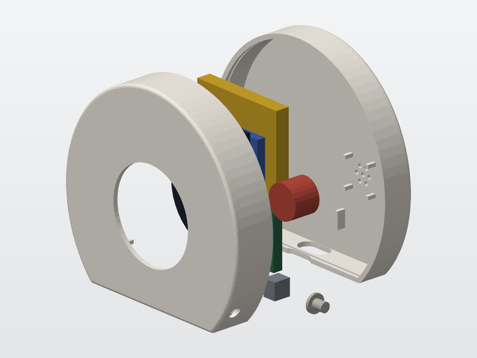

# Pocket Muse: a pocket buddy with eyes, built by Claude Code, re-wired to run from its battery

Claude Code built this in the round-5 check (2026-11-10) from a one-line wish, using only Faber's
tools over HTTP MCP: a Seeed XIAO RP2040, a 1.28 in round GC9A01 screen with two animated eyes, an
MPU-6050 that makes it scared when it falls and dizzy when you shake it, a pet button, a passive
buzzer that chirps, a 500 mAh LiPo and a TP4056 charger. 90 turns, $2.64, 11 min 22 s; its 8
scenarios passed.

What it could not do then (its own words): *"put a small 1N5817 diode between the charger's OUT+
and the board's 5V pin … The simulator has no diode part, so that one wire is left out of the
simulation."* So the battery powered nothing: in the simulation the board ran from an implied USB
cable, check_design flagged the battery on the charger as "parallel regulators" and told it to wire
the charger's USB input to the board's 5 V.

## What changed in round 6 (decision 0004, power track)

The circuit is the agent's, plus the power path it asked for:

| Added | Why |
| --- | --- |
| `pwr` slide switch (SS12D00) | turns it off without unplugging the cell (position 0 = on) |
| `d1` 1N5817 Schottky diode | between the switch and the XIAO's 5V pad (stripe towards the board), so USB on the XIAO never pushes current back into the cell |
| wires `w20` chg.OUT → pwr.2, `w21` pwr.1 → d1.A, `w22` d1.C → xiao.VBUS | cell → TP4056 BAT, OUT → switch → diode → XIAO 5V |
| `"power": { "usb": false }` | the simulation runs with no USB cable: the LiPo really powers it |
| `"assembly": "soldered"` | a pocket device is hand-wired, so the export writes wire cuts, not a breadboard |
| 3 scenarios | runs-from-the-battery, power-switch-off-and-on (it boots again), charges-while-it-runs |

The firmware (`firmware/main.ino`, `main.hex`) and the agent's 8 scenarios are unchanged.
`agent-actions.jsonl` is the agent's action log from the round-5 run, followed by the round-6 calls
made with the CLI (tests and a run on battery power, whose frames carry the round screen in colour
for replays and History, then `design_case` and `export_manufacturing`).

## What the simulation shows now

- USB unplugged, switch on: the cell (4.19 V) delivers about 44 mA through the diode (0.26 V drop);
  the XIAO's LDO holds 3.3 V; all 11 scenarios pass on battery power.
- Switch off: the board's 3.3 V rail drops, the firmware is held in reset; switch on: it boots
  again ("motion sensor ready").
- `check_design`: 0 errors, one warning, `ldo-dropout`: below a cell voltage of 3.85 V the 3V3 rail
  falls under 3.3 V and the XIAO stops at about 3.25 V, before the cell is empty (3.0 V). The
  firmware should read the cell and sleep before that (a 100 k / 100 k divider to an analog pin).
- `export/`: BOM with hook-up wire, heat-shrink and solder (no breadboard, no dupont),
  `WIRE-CUTS.csv` (22 wires: length, colour, 24 AWG power / 26 AWG signal), `ASSEMBLY.md`
  (power path first, measured before any module is connected), `firmware.uf2`, `TEST-ON-HARDWARE.md`.

Check it: `pnpm faber check -p examples/agent-built/claude-pocket-muse`,
`pnpm faber test -p examples/agent-built/claude-pocket-muse` (11/11),
`packages/session/test/power-muse.test.ts`.

## Its case (round 6, case track)

`case/` is the pebble case `design_case {"shape": "pebble"}` made for this circuit (regenerated in
round 6b): **70.7 × 94.3 × 19.6 mm, 97 cm³, "tight"** for a pocket (19.6 mm thick: up to 18 mm is
comfortable, up to 22 tight). It is rounded in 3D all round (6 mm front edge, 2.7 mm back edge),
both faces domed about 1 mm with a flat land round the window and a flat pad on the back. The
charger's USB-C is on the bottom, the XIAO's on the left, the pet button's cap on the right, the
switch lever through the top, the buzzer grille on the back. Every check passes (watertight, no
part touching the shell, wall, size, screen window, button travel, connector access, printable).
`case/variants/puck/` is a round variant to compare (72.7 × 72.7 × 25 mm, "bulky": 25 mm thick).
The STLs come in print orientation (each shell on its flat face) and `case.3mf` is a laid-out
build plate.

Files: `stl/` (front, back, the button cap), `case.3mf`, `step/`, `renders/`, `drawing/` (A3, SVG
and PDF), `PRINT.md`. `faber export_manufacturing -p <a copy>` writes the factory pack (35 files,
1.7 MB zip). In the app, open this example and press **Case**.

## What it does not prove

- Battery life: the drain follows the simulated load, but the display's and IMU's currents are
  typical figures; measure the real average current.
- The LDO's dropout, the diode's drop and the board's 25 mA are typical values, not your parts.
- Wire lengths in `export/WIRE-CUTS.csv` are estimated from the part sizes; the factory pack's
  `electronics/WIRE-CUTS.csv` takes them from the case layout. Lay the parts in the case before
  cutting either way.
- Everything in `export/TEST-ON-HARDWARE.md`.
