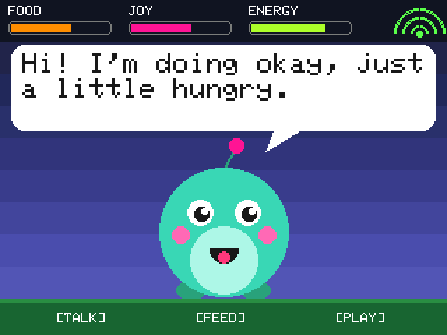
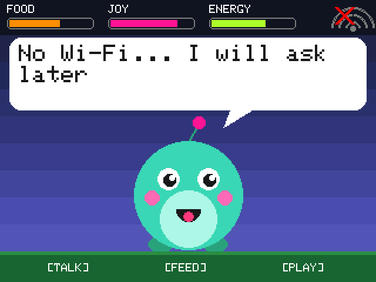

# AI pet

A pet with a language model inside, on a colour screen. An Arduino Uno draws it on a 2.8in
ILI9341 TFT and asks the pet AI what to say through an ESP-01 Wi-Fi module; the reply appears in a
speech bubble with a matching face. In the simulator the Wi-Fi is the sandbox network "JumperNet"
and the AI is `http://ai.jumper/v1/pet` (services/ai-gateway): a deterministic mock in tests, or
Claude (claude-haiku-5-5) through your logged-in `claude` CLI or `ANTHROPIC_API_KEY` when you
switch to Live.

<p align="center">
  
  
</p>

| Part | Id | Wiring |
| --- | --- | --- |
| Arduino Uno | `uno` | Runs `firmware/ai-pet.hex` |
| TFT 2.8in 320x240 ILI9341 (SPI) | `tft` | VCC → 5V, GND → GND, CS → D10, DC → D9, RESET → D8, MOSI → D11, SCK → D13, MISO → D12, LED → 5V |
| Wi-Fi ESP-01S (AT firmware) | `esp` | VCC → 3V3, GND → GND, TX → D2, RX ← D3 through a 1 kΩ / 2 kΩ divider (`rDiv1`, `rDiv2`) |
| Push buttons TALK / FEED / PLAY | `btnTalk`, `btnFeed`, `btnPlay` | D4 / D5 / D6 → `1a`, `2a` → GND (INPUT_PULLUP) |
| Active buzzer | `buzzer` | D7 → `POS`, `NEG` → GND |

## Behaviour

- Stats 0..100 (food, joy, energy), shown as bars. Every 2 s: food -1, joy -1; energy -1 every 4 s.
- **TALK** asks the AI (`a=talk`); **FEED** adds 25 food, **PLAY** adds 20 joy and costs 10 energy,
  and both ask the AI for a reaction. Left alone for 30 s the pet asks by itself (`a=lonely`), then
  at most once a minute.
- While it waits, the bubble shows `...`; the reply (`<mood>|<text>`, text <= 60 chars) stays 7 s,
  the face takes the reply's mood (with a blink in between), then follows the stats again
  (hungry < 30 food, sleepy < 25 energy, sad < 30 joy, excited > 85 joy).
- Wi-Fi: the top-right icon is amber while joining, green online, grey with a red X offline. When
  the Wi-Fi drops, a question waits ("No Wi-Fi... I will ask later") and is asked again after the
  module reconnects by itself; if it has not after 15 s, the sketch rejoins.
- The sketch moves a factory-fresh ESP-01 from 115200 to 9600 baud (`AT+UART_DEF`), because
  SoftwareSerial cannot receive 115200 reliably on an Uno. It waits for complete `OK\r\n` lines
  before sending, because SoftwareSerial cannot receive while it transmits: Jumper's UART is
  bit-exact, so that mistake garbles replies here exactly as on a bench.
- Serial at 115200: `Pet hatched`, `wifi: ...`, `icon: ...`, `ask a=talk f=.. j=.. e=..`,
  `reply 200 happy|...`, `bubble: ...`, `face: ...`, and `t=12 food=64 joy=58 energy=70 mood=happy wifi=1`
  every 2 s.

Flash 25.1 KB (77 %), globals 841 bytes (41 %) on the Uno.

## Try it

```sh
pnpm jumper test -p examples/ai-pet          # 5 scenarios, mock AI, deterministic
pnpm jumper mcp --project examples/ai-pet     # for Claude Code / Codex
node services/ai-gateway/bin/ai-gateway.mjs --ask talk   # one live reply from your claude CLI
```

Through MCP (once Integrate has routed the network tools): `run {ms: 7000}`, `interact btnTalk click`,
`run {ms: 2500}`, `screenshot`, `read_network_log`. For a real model: `set_ai_mode {mode: "live"}`
then `run_live {ms: 8000}` after pressing TALK (the simulation runs at real time and waits for
Claude). Tests and `run` always use the mock.

In the web app, the Network panel (apps/web/src/views/network) shows the requests and has the
Mock / Live switch; Live needs the gateway running (`node services/ai-gateway/bin/ai-gateway.mjs`).

## Scenarios (mock AI)

| Id | Checks |
| --- | --- |
| `boots-and-joins` | Screen on and filled (`tft.lit > 70000`), joins JumperNet within 8 s, online icon, no errors |
| `talk-shows-reply-bubble` | TALK → `ask a=talk` within 300 ms, `reply 200 <mood>|<text>` within 2.5 s, a white bubble (`tft.bright > 10000`) |
| `feed-raises-food` | FEED → food >= 85 at once, the AI's `happy|` reaction within 2.5 s |
| `wifi-drop-offline-and-retry` | `inject_fault esp wifi_drop` → offline icon, TALK waits, `clear` → back online, the same question is asked and answered |
| `lonely-asks-by-itself` | No buttons: `ask a=lonely` within 35 s and a reply bubble |

## On a real device

1. ESP-01 power from a 3.3 V regulator good for 300 mA (AMS1117-3.3, 10 µF + 100 nF), not the Uno
   3V3 pin (it gives about 150 mA; the module peaks at 170 to 300 mA and resets). Common ground.
2. Keep the 1k/2k divider on ESP RX.
3. In the sketch: `WIFI_SSID`, `WIFI_PASS`, `AI_HOST` = your computer's LAN IP, `AI_PORT 8787`.
4. On that computer: `node services/ai-gateway/bin/ai-gateway.mjs` (listens on 0.0.0.0:8787; allow
   it in the firewall). It answers with Claude when `claude` is logged in or `ANTHROPIC_API_KEY` is
   set, else with the mock, and prints one line per request.
5. Bare red ILI9341 modules have 3.3 V logic: add a 74HC4050 on CS, DC, RESET, MOSI, SCK (set the
   part's `logic` prop to `3v3-only` to get the warning in Jumper).

What the simulation does not tell you (from the parts' fidelity): radio range and packet loss,
TLS cost, ESP current peaks, panel gamma and viewing angle. See docs/decisions/0002-ai-pet.md.
