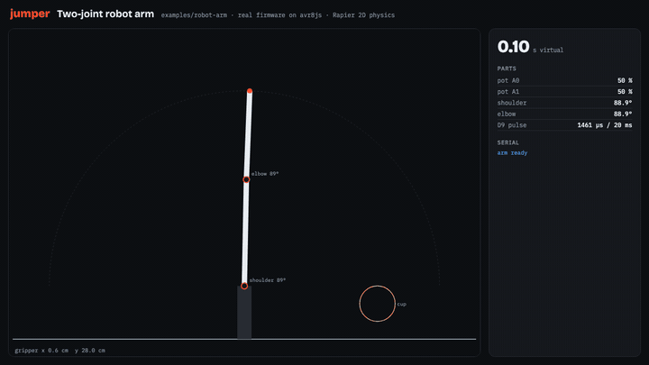

# Two-joint robot arm

Two SG90 servos make a planar arm (12 cm upper arm, 10 cm forearm). Two potentiometers set the
joint angles; the arm view shows the links move and whether the gripper reaches the cup.

Video: [`media/robot-arm.mp4`](media/robot-arm.mp4).

| Part | Id | Notes |
| --- | --- | --- |
| Arduino Uno | `uno` | Runs `firmware/robot-arm.hex`. |
| SG90 servo | `shoulder` | Signal ← D9 (OC1A), powered from 5V. |
| SG90 servo | `elbow` | Signal ← D10 (OC1B), powered from 5V. |
| Potentiometer | `potS`, `potE` | Wipers on A0 and A1, ends on 5V and GND. |

The sketch reads both pots and makes the servo pulses with Timer1 hardware PWM (50 Hz,
544–2400 µs), the same signal the Servo library makes. A Servo library version
(`#include <Servo.h>`, `servo.attach(9)`, `servo.write(angle)`) was checked in the simulator
too: pulses of 544 / 1007 / 2399 µs every 20.003 ms and the right angles. It is not the golden
build because the pinned toolchain image does not include the Servo library yet.

The `world.arm` block: base at (0, 6) cm (side view, y up), links `[12, 10]`, the shoulder angle is
the servo angle from horizontal, the elbow is straight at 90°. Target `cup` at (15, 4) cm.

## Scenarios (`fabwright test`)

`fabwright.json` has two scenarios an agent can run with `run_tests` (or `pnpm fabwright test -p examples/robot-arm`):
`reaches-the-cup` (pots set from inverse kinematics, then `world.reached` contains `cup`) and
`follows-the-pot`. Open the example in the app with `?example=robot-arm` to see the arm's side view.

## What the tests prove (`packages/physics/src/arm.integration.test.ts`)

* Turning a pot moves its servo to `pot × 180°` within 1.5° in 0.5 s.
* The pulses are measured to the CPU cycle: 50 Hz, 1461 µs for 89°.
* Inverse kinematics → pot positions → firmware → servos → the gripper ends inside the cup.

## What it does not prove

* Link weight and gravity: a real SG90 droops a few degrees under load and stalls at 1.8 kg·cm.
* Two servos on the Uno's 5 V pin may brown out the board on hardware when both move; use a separate 5–6 V supply.
* Most SG90s do not reach the full 0–180° the library asks for.
