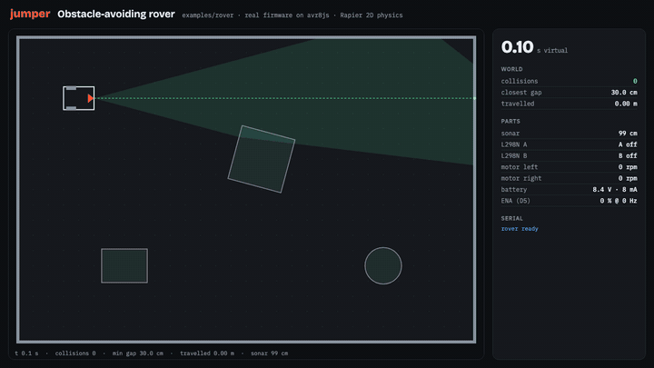

# Obstacle-avoiding rover

A 2WD robot car in a 300 × 200 cm arena: real Arduino firmware drives two motors through an
L298N and steers away from walls and obstacles with an HC-SR04 sonar. Physics (Rapier 2D) moves
the robot with the simulated motor speeds and feeds the sonar from a raycast.

Full 30 s video: [`media/rover.mp4`](media/rover.mp4) (recorded frame by frame in virtual time,
see `apps/web/src/renderers/physics/demo/record.mjs`).

| Part | Id | Notes |
| --- | --- | --- |
| Arduino Uno | `uno` | Runs `firmware/rover.hex`. |
| L298N dual H-bridge | `drv` | ENA ← D5 (PWM), IN1 ← D7, IN2 ← D8 (left); ENB ← D6 (PWM), IN3 ← D4, IN4 ← D2 (right). |
| 2 × TT gear motor | `mL`, `mR` | On OUT1/OUT2 and OUT3/OUT4. |
| HC-SR04 | `sonar` | TRIG ← D9, ECHO → D10, powered from the Uno 5V. |
| Battery pack | `bat` | 2S LiPo (8.4 V) on the L298N 12V terminal; the on-board regulator powers the driver logic. |
| 2WD chassis | `chassis` | Mechanical: wheel radius 3.25 cm, track 13.5 cm, 20 × 15 cm, 450 g. |

The `world` block in `jumper.json` places three obstacles and starts the robot at (40, 40) facing
+x. See [`packages/physics/README.md`](../../packages/physics/README.md) for the format.

## The sketch

Drive forward at PWM 170 while the sonar reads ≥ 28 cm. Closer: stop, back up 220 ms, then turn
right in 90 ms steps until it reads ≥ 55 cm. Each decision is printed on Serial (115200 baud).

## Scenarios (`jumper test`)

`jumper.json` has two scenarios an agent can run with `run_tests` (or `pnpm jumper test -p examples/rover`):
`drives-without-crashing` (20 s, `world.collisions == 0`, more than 3 m driven, never closer than
3 cm) and `sees-the-wall` (the sonar reads the far wall at start). Open the example in the app with
`?example=rover` to watch it drive in the World view.

## What the tests prove (`packages/physics/src/rover.integration.test.ts`)

* 30 virtual seconds, **0 collisions**, about 13 m driven, closest gap 7.5 cm.
* Deterministic: one 8 s run and 500 frames of 16 ms give bit-identical pose and pin traces;
  `reset()` replays the same run.
* `analogWrite(5, 170)` reaches the L298N as a 66 % duty (976.6 Hz, measured from cycle-stamped
  edges) and the motors turn at about two thirds of full speed.

## What it does not prove

* Real TT motors differ by 10–20 % in speed, so a real robot curves; the simulated ones are identical.
* Wheels do not load the motors; a robot pushing a wall keeps its motors at free speed.
* The sonar sees everything inside a 30° cone. Soft, round or angled things may not echo on hardware.
* Battery capacity is not modelled; the pack never runs down.
