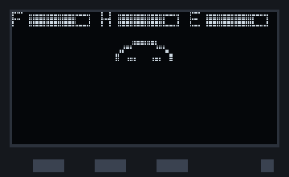

# Tamagotchi pet

Faber's reference "small device with a pixel pet": an Arduino Uno, a 128x64 SSD1306 OLED on
I2C, three buttons and an active buzzer. The pet has food, happiness and energy; you feed it,
play with it and put it to sleep, and it beeps when it needs you.

This is the **reference** build. Agent evaluations must build their own from the one-line goal;
this one is here to compare against and to prove the parts, the bus and the libraries work.

| Part | Id | Wiring |
| --- | --- | --- |
| Arduino Uno | `uno` | Runs `firmware/tamagotchi.hex` |
| OLED 128x64 SSD1306 (I2C, 0x3C) | `oled` | GND → GND, VCC → 5V, SDA → A4, SCL → A5 |
| Push button "feed" | `btnFeed` | `uno.D2` → `1a`, `2a` → GND (INPUT_PULLUP, pressed = LOW) |
| Push button "play" | `btnPlay` | `uno.D3` → `1a`, `2a` → GND |
| Push button "sleep" | `btnSleep` | `uno.D4` → `1a`, `2a` → GND |
| Active buzzer | `buzzer` | `uno.D8` → `POS`, `NEG` → GND |

`media/tamagotchi.mp4` / `media/tamagotchi.gif`: 13.5 s of the simulated OLED (feed, play twice,
sleep, wake), recorded from the simulator with the web renderer's painter. The squares under the
screen light up for the feed/play/sleep buttons and the buzzer. Rows can show half-drawn while
`display.display()` is still sending the frame over I2C (about 95 ms at 100 kHz), as on a real
module.

## Behaviour

- Stats 0..100, higher is better, start at 80. Each second awake: food -2, happy -1, energy -1.
  Asleep: energy +4, food -1; it wakes by itself at 100 energy.
- **Feed** (D2): food +25 (or "not hungry" above 90, which costs 5 happiness). Short beep.
- **Play** (D3): happy +20, energy -10, food -5; "too tired" under 15 energy. Beep.
- **Sleep** (D4): toggles sleep; the screen dims (contrast 0x10) and shows Zzz. Feed and play are
  ignored while it sleeps.
- Any stat under 20: sad face, "I need you!", and a 300 ms alarm beep every 5 s.
- The pet bounces one pixel every 500 ms and blinks every 4 s (idle animation).
- Serial, 115200 baud: `Pet hatched`, then once a second
  `t=12 food=56 happy=68 energy=68 mood=happy sleeping=0`, plus one line per event
  (`feed food=100`, `play happy=99`, `sleep`, `wake`, `beep: needs care`).
- Without a display it says `OLED not found at 0x3C, running headless` and keeps going.

## Tests

`faber.json` has six scenarios (run them with `faber test` or the `run_tests` tool):
`boots-and-draws`, `feed-fills-food`, `play-beeps`, `sleep-and-wake`, `neglect-makes-it-sad`,
`runs-headless-without-display` (injects an I2C NACK on the OLED). They are deterministic: the
same numbers every run. `packages/parts/src/tamagotchi.integration.test.ts` checks the same
behaviour straight on the `Simulation`.

## Files

- `firmware/tamagotchi/tamagotchi.ino`: the sketch (Adafruit_SSD1306 + Adafruit_GFX).
- `firmware/tamagotchi.hex`: the golden build; rebuild as in [`firmware/BUILD.md`](firmware/BUILD.md).

## What this proves, and what it does not

It proves the I2C bus (AVR TWI) carries a real library's traffic at real timing, the SSD1306
model draws what Adafruit_SSD1306 sends, buttons with INPUT_PULLUP, and that the buzzer gets
current from a GPIO. It does not prove: OLED refresh/flicker, button bounce (the simulated
button is clean; the sketch debounces anyway), buzzer loudness, or current draw on a battery.
