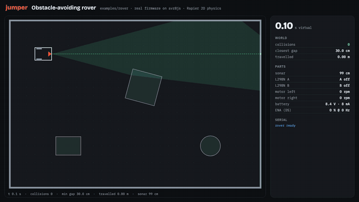

# @faber/physics

Deterministic physics for Faber robots. A project that has a `"world"` block in its `faber.json`
gets a body: a 2WD rover drives around a top-down arena (Rapier 2D) with the speed of its
simulated motors, its HC-SR04 sees the walls through a raycast, and a servo arm moves its links
with its simulated servos. Everything is stepped by the simulation clock, so runs are
reproducible and can be tested ("the rover never collides in 30 s").

<p align="center"></p>

## The `world` block

Units are centimetres and degrees. Top view: x to the right, **y down** (like the canvas),
heading 0 = facing +x, 90 = facing +y. Errors name the field, say what is wrong and how to fix it.

```json
"world": {
  "arena": { "width": 300, "height": 200 },
  "walls": [{ "x1": 0, "y1": 100, "x2": 120, "y2": 100 }],
  "obstacles": [
    { "id": "crate", "shape": "box", "x": 160, "y": 80, "w": 36, "h": 36, "angle": 15 },
    { "id": "pillar", "shape": "circle", "x": 240, "y": 150, "r": 12 }
  ],
  "robot": { "start": { "x": 40, "y": 40, "heading": 0 } }
}
```

| Field | Default | Notes |
| --- | --- | --- |
| `arena.width/height` | 300 × 200 | Floor size. Four walls are added around it (`enclosed: false` to drop them; `wallThickness` 2). |
| `walls[]` | – | Segments `x1,y1 → x2,y2`, `thickness` 2. |
| `obstacles[]` | – | `box` (centre `x,y`, `w`, `h`, `angle`) or `circle` (`x,y`, `r`). Give them an `id` to see it in `touching`. |
| `robot.chassis` | the only `robot-chassis-2wd` | Body size, mass, wheel radius, track width, grip and sensor offset come from its props. |
| `robot.leftMotor/rightMotor` | the two `dc-motor` parts whose ids say left/right | Positive motor rpm drives that wheel forward. |
| `robot.sonar` | the only `hc-sr04` | Mounted at the front, facing forward. |
| `robot.imu` | – | An `mpu6050` mounted flat (x forward, y left, z up), fed every step with `accelX/accelY` (g) from the body's acceleration, `accelZ` = 1 g and `gyroZ` (°/s, counter-clockwise from above positive). |
| `robot.start` | `{ x: 40, y: 40, heading: 0 }` | Body centre and heading. |
| `arm.base` | `{ x: 0, y: 0 }` | Side view, **y up**, cm. |
| `arm.links[]` | – | Link lengths in cm, shoulder first. |
| `arm.joints[]` | – | One per link: `servo` (part id), `zero` (servo angle where the joint is at `offset`; 0 for the shoulder, 90 for the others), `direction` (±1), `offset` (deg). Shoulder angle is from +x, the others relative to the previous link. |
| `arm.targets[]` | – | `{ id, x, y, r }` points the gripper should reach (`reached` lists them). |

`parseProject()` keeps the block as-is in `project.world`; `parseWorld(project.world, project)` (or
`attachPhysics`) validates it. `worldOf(faberJsonText)` reads it straight from the file.

## Wiring it to a simulation

```ts
import { attachPhysics, initPhysics, worldOf } from "@faber/physics";

await initPhysics();                                  // loads Rapier's WebAssembly, once
const sim = new Simulation({ project, registry, backendFactory, firmware });
const phys = attachPhysics(sim, project.world);          // or worldOf(rawFaberJson)
sim.runFor(30_000);                                   // physics steps every 4 ms of virtual time
phys.stats();      // { timeS, collisions, minClearanceCm, travelledCm, pose }
phys.snapshot();   // everything the World / Arm views draw
```

What flows each 4 ms step:

* motors → wheels: each `dc-motor`'s `omega` (rad/s) × wheel radius is the wheel's surface speed;
* world → sonar: the nearest hit of 7 rays over ±15° from the sensor, as `distance` (cm, 0 = nothing within 400 cm);
* world → chassis part state: `x`, `y`, `heading`, `collisions`, `minClearance`, `clearance`, `travelled`, `speed`. So a scenario can say `{ "expect_part": "chassis.collisions", "op": "==", "value": 0 }` and an agent can read the pose with `get_part`;
* servos → arm: each servo's `angle` through forward kinematics. `armReach(spec, x, y)` gives the servo angles for a point (inverse kinematics).

## Determinism

* Fixed timestep (4 ms), stepped from `sim.every()` at fixed CPU cycles, never from a frame loop.
* No wall clock, no randomness. Rapier 2D gives bit-identical results for the same inputs on the
  same build.
* Proof (tests): `rover.integration.test.ts` runs the rover once for 8 s and once as 500 frames
  of 16 ms: identical pose hash, identical pin trace, identical stats; `reset()` replays the same
  hash. The 30 s run in Chromium (the demo page) ends with the same closest gap as in Node,
  7.469547539949417 cm, to the last digit.

## Fidelity

| Area | What is modelled | What is not |
| --- | --- | --- |
| Drive | Each wheel is a velocity constraint at its contact point, limited by grip × 40 % of the weight (Coulomb friction); the caster adds rolling drag; Rapier resolves collisions with walls/obstacles | Motor load: wheels do not slow the motors (a robot pushing a wall keeps its motors at free speed), weight transfer, bumps, slopes, wheel-diameter mismatch |
| Sonar | 7 rays over a 30° cone, nearest hit, 400 cm range, 2 cm minimum in the part | Beam shape, soft/round/angled targets that do not echo, multipath, noise |
| Arm | Forward kinematics of the servo angles (servos model their own speed and end stops) | Link mass, gravity sag, torque limits, collisions between links and the table |
| Timing | 250 Hz physics on the CPU clock | Sub-step events (a collision is detected at the next 4 ms step) |

## Package API

`initPhysics`, `parseWorld`, `worldOf`, `WorldSpecError`, `attachPhysics`, `RoverWorld`,
`armPose`, `armReach`, `robotBodyFromState`, `PHYSICS_DT`, `PHYSICS_STEP_MS`,
`SONAR_HALF_ANGLE_DEG`, `SONAR_RAYS`, `SONAR_MAX_CM`, and the types `WorldSpec`, `PhysicsBinding`,
`WorldSnapshot`, `PhysicsStats`, `Pose`, `SonarReading`, `ArmPose`.

The web views live in `apps/web/src/renderers/physics/` (`registerPhysicsViews()`, `WorldView`,
`ArmView`). `apps/web/src/renderers/physics/demo/` is a standalone page and a recorder that makes
the videos in `examples/*/media/` frame by frame in virtual time.
